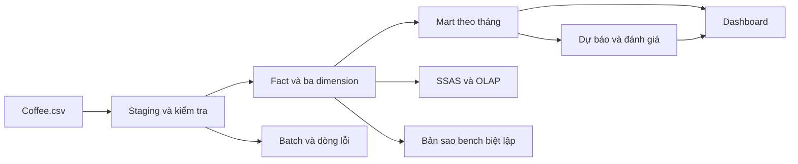

# Coffee DW

Bộ khung làm chung cho bài tập lớn môn Kho dữ liệu trên `Coffee.csv`. Dự án có hai phần: **thực nghiệm kiến thức môn học** và **dashboard, AI dự báo doanh số**. Checklist bao phủ bảy chương và TN01–TN13 trong hai tài liệu báo cáo hiện có.

| Thành viên | Chương | Phần phụ trách |
| --- | --- | --- |
| Thanh | 1–3 | Bài toán, lý thuyết, hồ sơ nguồn, grain, thiết kế kho |
| Chi | 4–5 | ETL, chất lượng, SCD, data mart, SSIS và SSAS/OLAP |
| Trang | 6–7 | Dự báo, dashboard, benchmark, tích hợp và nghiệm thu |

**Mới vào repo:** đọc [bắt đầu tại đây và prompt cho Thanh/Chi](docs/START_HERE.md). Khi làm bằng agent, yêu cầu đọc [AGENTS.md](AGENTS.md) trước.

Xem [phân công](docs/TEAM_WORKFLOW.md), [ánh xạ toàn bộ báo cáo](docs/REPORT_MAP.md), [checklist từng chương](docs/chapters/) và [trạng thái base](docs/BASE_STATUS.md).

## Chạy nhanh

Dùng Python 3.12, chạy tại thư mục gốc. Script tự tìm Python, tạo `.venv` và cài package của dự án:

```powershell
powershell -ExecutionPolicy Bypass -File scripts/setup.ps1
.\.venv\Scripts\python -m coffee_dw.cli demo
.\.venv\Scripts\python -m coffee_dw.cli forecast
.\.venv\Scripts\python -m pytest
.\.venv\Scripts\python -m streamlit run apps/dashboard/app.py
```

Mở địa chỉ Streamlit in ra, thường là `http://localhost:8501`. Không cần kích hoạt venv. Nếu máy đã cấu hình `py` đúng, có thể cài thủ công:

```powershell
py -3.12 -m venv .venv
.\.venv\Scripts\python -m pip install -e ".[dev]"
```

Trên Linux/macOS dùng `python3 -m venv .venv`, sau đó thay `.\.venv\Scripts\python` bằng `.venv/bin/python`. Không cần SQL Server để chạy bản tham chiếu cục bộ. Cách chạy app theo [tài liệu Streamlit](https://docs.streamlit.io/develop/concepts/architecture/run-your-app).

## Cấu trúc

```text
learning/                 Phần 1: bài thử SCD, tăng dần, HRU và hướng dẫn TN01–13
sql/sqlserver/            DDL, procedure ETL, mart, đối soát và benchmark T-SQL
ssis/                     Nơi Chi xây package SSIS và thu log Data Flow
ssas/                     Nơi Chi xây cube, phân cấp và kiểm tra MDX
apps/dashboard/           Phần 2: giao diện Streamlit, KPI, drill-down, CSV, AI
src/coffee_dw/            Logic nguồn, kho dùng chung, CLI và dự báo
scripts/                  Setup, cầu nối SQL Server và tổng hợp số đo
tests/                    Kiểm tra tính đúng dữ liệu, ETL, dự báo và bộ lọc
data/raw/Coffee.csv       Nguồn gốc, giữ nguyên và cùng version trên Git
data/warehouse/           Kho SQLite sinh cục bộ, không commit
docs/chapters/            Mỗi chương một file để ba người viết song song
results/                  Kết quả thực chạy; có mẫu benchmark và phiếu nghiệm thu
.github/                  CI và mẫu Pull Request
```



SQLite là bản tham chiếu chạy được để cả nhóm phát triển chung. Bộ khung SQL Server có schema, procedure nạp và script thử; package SSIS, project SSAS và phép đo trên SQL Server cần nhóm triển khai, chạy và lưu minh chứng trên công cụ tương ứng. Các phép thử SQLite không thay bằng chứng native.

## Lệnh và đầu ra

| Lệnh | Đầu ra |
| --- | --- |
| `python -m coffee_dw.cli profile` | `results/TN01/profile.json`: hồ sơ và cảnh báo nguồn |
| `python -m coffee_dw.cli load` | Kho SQLite, audit/reject, `results/TN03/load.json` |
| `python -m coffee_dw.cli demo` | Profile và nạp kho tham chiếu |
| `python -m coffee_dw.cli forecast` | `results/forecast/`: metrics, predictions, next_month, summary; bảng ForecastSales |
| `python learning/experiments/scd.py` | TN04: Type 1/2/3 trên dữ liệu mô phỏng biệt lập |
| `python learning/experiments/incremental.py` | TN03: 23 kỳ + kỳ mới + phát lại + sửa số + dòng lỗi |
| `python learning/experiments/hru.py` | TN13: lattice, workload giả định và chọn view theo ngân sách |

CLI `profile`, `load`, `demo` nhận thêm `--source` và `--db`; `forecast` nhận `--db`. Copy `.env.example` thành `.env` nếu cần đổi đường dẫn/ODBC. File `.env` không được đưa lên Git. App đọc kho đã nạp, trang AI đọc kết quả đã tạo; khi sửa nguồn cần nạp lại và chạy lại forecast.

## Quy ước dữ liệu

Grain là **tháng × mã vùng × sản phẩm**; 4.248 dòng là quan sát tổng hợp, không phải số đơn hàng. Ngày Excel dùng mốc `1899-12-30`. Giữ mã vùng dạng chuỗi, 11 số đo nguồn, Profit âm, Inventory âm và chênh đẳng thức kế toán để đối soát. Không tự tính đè chỉ tiêu nguồn.

Nguồn hiện có 24 tháng, từ 01/2012 đến 12/2013, 4 thị trường, 156 mã vùng và 13 sản phẩm. Mốc đối soát: Sales **819.811**, BudgetSales **746.160**, Profit **259.543**. Tỷ lệ đạt ngân sách là **tổng Sales / tổng BudgetSales** trong cùng bộ lọc. Inventory chỉ tổng theo địa bàn/sản phẩm trong kỳ cuối được chọn; không cộng qua nhiều tháng. CSV không công bố đơn vị tiền tệ.

Forecast so sánh tháng trước, trung bình ba tháng và Ridge ba lag. Sáu kỳ 04–09/2013 dùng chọn phương pháp theo MAE; ba kỳ 10–12/2013 dùng kiểm tra độc lập với lựa chọn. Mỗi dự báo chỉ dùng các tháng trước mục tiêu, gồm cả bước chuẩn hóa. Dự báo 01/2014 là kỳ ngoài nguồn lịch sử, chưa có actual để chấm sai số. Quy tắc tránh rò rỉ theo [tài liệu scikit-learn](https://scikit-learn.org/stable/common_pitfalls.html).

## SQL Server và công cụ môn học

1. Chạy `sql/sqlserver/00_create_database.sql`, `01_schema.sql`, `02_marts.sql`, `03_load_staging.sql` trong SSMS theo thứ tự.
2. Cài extra `python -m pip install -e ".[sqlserver]"`, cài Microsoft ODBC Driver 18 và điền connection string trong `.env`.
3. Chạy `python scripts/load_sqlserver.py`, rồi `04_checks.sql` để đối soát.
4. Chi xây package theo [hướng dẫn SSIS](ssis/README.md), tạo cube theo [hướng dẫn SSAS](ssas/README.md), lưu project native vào các thư mục này.
5. Trang chạy `05_bench_setup.sql` đến `09_benchmark_protocol.sql` trong vùng `bench`, thu actual plans và 15 lượt đo mỗi cấu hình. Indexed view có [SET options và chi phí duy trì riêng](https://learn.microsoft.com/en-us/sql/relational-databases/views/create-indexed-views).

Các script không xóa kho hiện có. Benchmark mặc định nhân nguồn 500 lần, tạo 2.124.000 dòng trong `bench`; cần đủ bộ nhớ/ổ đĩa. Tập nhân bản chỉ dùng thử tải. Dashboard mặc định dùng SQLite; chuyển sang SQL Server qua cùng hợp đồng mart là phần tích hợp tiếp theo của nhóm.

## Làm chung trên Git

Repository: `https://github.com/trangtretrau2005/Data_warehousing.git`. Mỗi người dùng nhánh riêng, mở PR vào `main`; hướng dẫn ở [CONTRIBUTING](CONTRIBUTING.md). Không đẩy `.env`, venv, kho cục bộ hoặc cache. Kết quả sinh ra được ignore; xem [quy ước chọn minh chứng](results/README.md).

Ví dụ bắt đầu một phần việc mới của Thanh sau khi clone:

```powershell
git switch main
git pull --ff-only origin main
git switch -c thanh/ch01-03-schema
# Sửa file, chạy kiểm tra, rồi chọn file cần commit.
git add docs/chapters/ch01_thanh.md
git diff --cached
git commit -m "docs: clarify business questions"
git push -u origin thanh/ch01-03-schema
```

Chi và Trang dùng nhánh theo phần của mình. Sau khi push nhánh, mở Pull Request vào `main` để thành viên khác đọc và kiểm tra. Quyền collaborator và quy tắc bảo vệ nhánh do nhóm quản lý trên GitHub.
