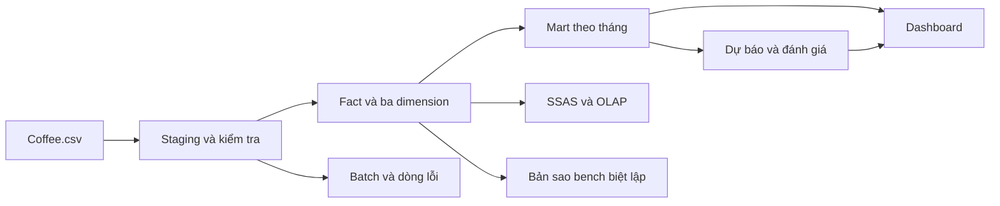

# Coffee DW

Bộ khung làm chung cho bài tập lớn môn Kho dữ liệu trên `Coffee.csv`. Dự án có hai phần: **thực nghiệm kiến thức môn học** và **dashboard, AI dự báo doanh số**. Checklist bao phủ bảy chương và TN01–TN13 trong hai tài liệu báo cáo hiện có.

| Thành viên | Chương | Phần phụ trách |
| --- | --- | --- |
| Thanh | 1–3 | Bài toán, lý thuyết, hồ sơ nguồn, grain, thiết kế kho |
| Chi | 4–5 | ETL, chất lượng, SCD, data mart, SSIS và SSAS/OLAP |
| Trang | 6–7 | Dự báo, dashboard, benchmark, tích hợp và nghiệm thu |

## Bản tích hợp Chi và Trang

Mở [Coffee Datacube 3D trên SQL Server](http://127.0.0.1:8504) để trình diễn chương 4–5. Phần trình diễn chính của Trang là [Giải thích chênh lệch theo quý](http://127.0.0.1:8504/quarter.html): chọn Market và quý, sau đó drill-down theo tháng → nhóm sản phẩm → sản phẩm rồi mở đúng ô trên khối 3D. Trang [Coffee Query Studio](http://127.0.0.1:8504/query.html) có bộ chọn `SUM`/`AVG` và Gemini Text-to-SQL cho COUNT, MIN/MAX, tỷ lệ, top-N, sắp xếp và nhóm; mọi SELECT của AI phải qua parser AST, allowlist mart, giới hạn dòng và kết nối chỉ-đọc. [Linear Lab](http://127.0.0.1:8504/linear.html) thử quan hệ Marketing–Sales theo từng Market với 18 tháng train và 6 tháng test; đây là what-if giải thích được, không thay forecast một tháng tới. Xem [kịch bản drill-down](docs/trang/quarter_drilldown.md), [thiết kế Query Studio](docs/trang/query_studio.md) và [báo cáo Linear Regression](docs/trang/linear_marketing.md). Từ thư mục gốc, khởi chạy trên máy Trang bằng lệnh sau khi SQL Server và kho nghiệm thu đã sẵn sàng.

**Một cổng, một lộ trình:** trên `8504`, trình bày theo thứ tự **01 Giải thích chênh lệch → 02 Cube 3D beta → 03 Truy vấn và kiểm chứng → 04 Mô hình thử nghiệm**. Phần chắc chắn để bảo vệ là ETL, mart, KPI, SQL/SSAS đã đối soát và phép drill-down số học. Cube 3D, Gemini, forecast và Linear Lab là lớp thử nghiệm đang phát triển; không dùng chúng để tuyên bố hệ thống đã dự báo chính xác, chứng minh quan hệ nhân quả hoặc sẵn sàng vận hành thật.

```powershell
.\.venv\Scripts\python.exe apps/cube_explorer/server.py --backend sqlserver --database CoffeeDW_Trang_SSIS_TN03_20261120 --port 8504
```

Chi chủ trì thiết kế và thực nghiệm ETL, SCD, mart và OLAP. Có thể mở trực tiếp [solution SSIS của Chi](ssis/CoffeeETL/CoffeeETL.sln), [solution SSAS của Chi](ssas/CoffeeCube/CoffeeCube.sln) và [bộ truy vấn MDX](ssas/queries.mdx). Bốn hồ sơ gốc chứa đủ 24 tệp minh chứng từ commit `fd62d4b`.

| Thực nghiệm của Chi | Hồ sơ gốc |
| --- | --- |
| TN03 — Nạp, phát lại, sửa số và loại dòng lỗi | [Batch, số đối soát và ảnh SSIS](results/TN03/chi_2026-11-15/experiment.md) |
| TN04 — SCD và tra cứu lịch sử | [Kết quả và ảnh kiểm tra](results/TN04/chi_2026-11-15/experiment.md) |
| TN05 — Mart và drill-across | [Truy vấn, kết quả và ảnh](results/TN05/chi_2026-11-15/experiment.md) |
| TN06 — Cube, MDX và OLAP | [Kịch bản, ảnh và trạng thái ghi trong biên bản của Chi](results/TN06/chi_2026-11-15/experiment.md) |

Luồng demo trên máy Trang dùng [SSIS Data Flow](ssis/CoffeeETLTrang/README.md) và [bộ tám ca CSV](ssis/CoffeeETLTrangAcceptance/README.md) để nạp kho biệt lập. [Cube SSAS](ssas/CoffeeCubeTrang/README.md) đọc mô hình sao của kho đó. Web đọc mart SQL của cùng kho. Hồ sơ ngày 20/11 ghi lần nạp và ProcessFull. Ngày 22/11, nhóm đối soát chỉ đọc trên dữ liệu đã nạp, đạt [17/17 truy vấn MDX so với SQL](results/final_chi_trang_20261122/comparison.json).

Để trình diễn ca của Chi, chọn tháng 08/2013 và Market South trên web. Sales 4.601, BudgetSales 4.610, Gap −9. Bảy sản phẩm khớp SQL và cube ở cả bốn số Sales, BudgetSales, Profit và Gap. Riêng Colombian có Gap −268. [Kết quả đối soát và kiểm kê tệp của Chi](results/final_chi_trang_20261122/handoff.json).

[Thử nghiệm chọn ba trường hợp cần kiểm tra](http://127.0.0.1:8504/triage.html) và [báo cáo metric](experiments/triage/README.md) được giữ như một nghiên cứu phụ.

## Ứng dụng

| Ứng dụng | Cổng | Cách chạy |
| --- | --- | --- |
| Giải thích chênh lệch theo quý | 8504 | [Mở phần trình diễn chính](http://127.0.0.1:8504/quarter.html) |
| Coffee Query Studio | 8504 | [Mở bộ tạo SQL và Gemini](http://127.0.0.1:8504/query.html) |
| Linear Lab Marketing–Sales | 8504 | [Mở thử nghiệm hồi quy](http://127.0.0.1:8504/linear.html) |
| Coffee Datacube 3D trên SQL Server | 8504 | Dùng lệnh ở phần bản tích hợp |
| Coffee Datacube 3D trên SQLite | 8503 | [Hướng dẫn Cube Explorer](apps/cube_explorer/README.md) |
| Dashboard KPI và dự báo | 8501 | [Hướng dẫn dashboard](apps/dashboard/README.md) |
| Demo thuyết minh dự báo | 8502 | [Chuẩn bị dữ liệu và chạy demo](apps/forecast_demo/README.md) |

Người mới xem [hướng dẫn theo vai trò](docs/START_HERE.md), [quy ước làm việc](AGENTS.md) và các bước thiết lập bên dưới.

## Chạy nhanh

Dùng Python 3.12, chạy tại thư mục gốc. Script tự tìm Python, tạo `.venv` và cài package của dự án:

```powershell
powershell -ExecutionPolicy Bypass -File scripts/setup.ps1
.\.venv\Scripts\python -m coffee_dw.cli demo
.\.venv\Scripts\python -m coffee_dw.cli forecast
.\.venv\Scripts\python -m pytest
.\.venv\Scripts\python -m streamlit run apps/dashboard/app.py
```

Mở địa chỉ Streamlit in ra, thường là `http://localhost:8501`. Không cần kích hoạt venv. Nếu máy đã cấu hình `py` đúng, có thể cài thủ công:

```powershell
py -3.12 -m venv .venv
.\.venv\Scripts\python -m pip install -e ".[dev]"
```

Trên Linux/macOS dùng `python3 -m venv .venv`, sau đó thay `.\.venv\Scripts\python` bằng `.venv/bin/python`. Không cần SQL Server để chạy bản tham chiếu cục bộ. Cách chạy app theo [tài liệu Streamlit](https://docs.streamlit.io/develop/concepts/architecture/run-your-app).

## Cấu trúc

```text
learning/                 Phần 1: bài thử SCD, tăng dần, HRU và hướng dẫn TN01–13
sql/sqlserver/            DDL, procedure ETL, mart, đối soát và benchmark T-SQL
ssis/                     Nơi Chi xây package SSIS và thu log Data Flow
ssas/                     Nơi Chi xây cube, phân cấp và kiểm tra MDX
apps/dashboard/           Phần 2: giao diện Streamlit, KPI, drill-down, CSV, AI
src/coffee_dw/            Logic nguồn, kho dùng chung, CLI và dự báo
scripts/                  Setup, cầu nối SQL Server và tổng hợp số đo
tests/                    Kiểm tra tính đúng dữ liệu, ETL, dự báo và bộ lọc
data/raw/Coffee.csv       Nguồn gốc, giữ nguyên và cùng version trên Git
data/warehouse/           Kho SQLite sinh cục bộ, không commit
docs/chapters/            Mỗi chương một file để ba người viết song song
results/                  Kết quả thực chạy; có mẫu benchmark và phiếu nghiệm thu
.github/                  CI và mẫu Pull Request
```



SQLite là bản tham chiếu chạy được để cả nhóm phát triển chung. Bộ khung SQL Server có schema, procedure nạp và script thử; package SSIS, project SSAS và phép đo trên SQL Server cần nhóm triển khai, chạy và lưu minh chứng trên công cụ tương ứng. Các phép thử SQLite không thay bằng chứng native.

## Lệnh và đầu ra

| Lệnh | Đầu ra |
| --- | --- |
| `python -m coffee_dw.cli profile` | `results/TN01/profile.json`: hồ sơ và cảnh báo nguồn |
| `python -m coffee_dw.cli load` | Kho SQLite, audit/reject, `results/TN03/load.json` |
| `python -m coffee_dw.cli demo` | Profile và nạp kho tham chiếu |
| `python -m coffee_dw.cli forecast` | `results/forecast/`: metrics, predictions, next_month, summary; bảng ForecastSales |
| `python learning/experiments/scd.py` | TN04: Type 1/2/3 trên dữ liệu mô phỏng biệt lập |
| `python learning/experiments/incremental.py` | TN03: 23 kỳ + kỳ mới + phát lại + sửa số + dòng lỗi |
| `python learning/experiments/hru.py` | TN13: lattice, workload giả định và chọn view theo ngân sách |

CLI `profile`, `load`, `demo` nhận thêm `--source` và `--db`; `forecast` nhận `--db`. Copy `.env.example` thành `.env` nếu cần đổi đường dẫn/ODBC. File `.env` không được đưa lên Git. App đọc kho đã nạp, trang AI đọc kết quả đã tạo; khi sửa nguồn cần nạp lại và chạy lại forecast.

## Quy ước dữ liệu

Grain là **tháng × mã vùng × sản phẩm**; 4.248 dòng là quan sát tổng hợp, không phải số đơn hàng. Ngày Excel dùng mốc `1899-12-30`. Giữ mã vùng dạng chuỗi, 11 số đo nguồn, Profit âm, Inventory âm và chênh đẳng thức kế toán để đối soát. Không tự tính đè chỉ tiêu nguồn.

Nguồn hiện có 24 tháng, từ 01/2012 đến 12/2013, 4 thị trường, 156 mã vùng và 13 sản phẩm. Mốc đối soát: Sales **819.811**, BudgetSales **746.160**, Profit **259.543**. Tỷ lệ đạt ngân sách là **tổng Sales / tổng BudgetSales** trong cùng bộ lọc. Inventory chỉ tổng theo địa bàn/sản phẩm trong kỳ cuối được chọn; không cộng qua nhiều tháng. CSV không công bố đơn vị tiền tệ.

Forecast so sánh tháng trước, trung bình ba tháng và Ridge ba lag. Sáu kỳ 04–09/2013 dùng chọn phương pháp theo MAE; ba kỳ 10–12/2013 dùng kiểm tra độc lập với lựa chọn. Mỗi dự báo chỉ dùng các tháng trước mục tiêu, gồm cả bước chuẩn hóa. Dự báo 01/2014 là kỳ ngoài nguồn lịch sử, chưa có actual để chấm sai số. Quy tắc tránh rò rỉ theo [tài liệu scikit-learn](https://scikit-learn.org/stable/common_pitfalls.html).

Linear Marketing–Sales là thử nghiệm riêng ở grain Market–tháng: fit 18 tháng đầu, kiểm tra 6 tháng cuối. R² test âm ở cả bốn Market nên chưa gộp hoặc dùng thay forecast; chức năng được giữ như phần giải thích tương quan và kịch bản có cảnh báo. Không sinh thêm Sales để nâng metric. Xem [protocol, số liệu và quyết định tích hợp](docs/trang/linear_marketing.md).

## SQL Server và công cụ môn học

1. Chạy `sql/sqlserver/00_create_database.sql`, `01_schema.sql`, `02_marts.sql`, `03_load_staging.sql` trong SSMS theo thứ tự.
2. Cài extra `python -m pip install -e ".[sqlserver]"`, cài Microsoft ODBC Driver 18 và điền connection string trong `.env`.
3. Chạy `python scripts/load_sqlserver.py`, rồi `04_checks.sql` để đối soát.
4. Chi xây package theo [hướng dẫn SSIS](ssis/README.md), tạo cube theo [hướng dẫn SSAS](ssas/README.md), lưu project native vào các thư mục này.
5. Trang chạy `05_bench_setup.sql` đến `09_benchmark_protocol.sql` trong vùng `bench`, thu actual plans và 15 lượt đo mỗi cấu hình. Indexed view có [SET options và chi phí duy trì riêng](https://learn.microsoft.com/en-us/sql/relational-databases/views/create-indexed-views).

Các script không xóa kho hiện có. Benchmark mặc định nhân nguồn 500 lần, tạo 2.124.000 dòng trong `bench`; cần đủ bộ nhớ/ổ đĩa. Tập nhân bản chỉ dùng thử tải. Dashboard mặc định dùng SQLite; chuyển sang SQL Server qua cùng hợp đồng mart là phần tích hợp tiếp theo của nhóm.

## Báo cáo và thực nghiệm

- **Thanh, chương 1–3.** Xem [kiến trúc và hợp đồng dữ liệu](docs/architecture.md) và checklist trong [bản đồ báo cáo](docs/REPORT_MAP.md).
- **Chi, chương 4–5.** Xem bảng TN03–TN06 ở đầu trang, [checklist ETL](docs/chapters/ch04_chi.md) và [checklist OLAP](docs/chapters/ch05_chi.md).
- **Trang, chương 6–7.** Xem [hồ sơ dự báo, triển khai và kịch bản bảo vệ](docs/trang/README.md), [TN12 West](experiments/tn12_west/README.md) và [benchmark SQL Server TN07–TN10/HRU](docs/TRANG_NATIVE_HANDOFF.md). Xem thêm [EDA](explore/README.md), [baseline](experiments/baseline/README.md), [tuning](experiments/tuning/README.md) và [demo tổng hợp nghiên cứu](experiments/briefing/README.md).
- **Cả nhóm.** Theo dõi [trạng thái và giới hạn nghiệm thu](docs/BASE_STATUS.md), [quy trình phối hợp](docs/TEAM_WORKFLOW.md) và [quy ước lưu minh chứng](results/README.md).

## Làm chung trên Git

Repository: `https://github.com/trangtretrau2005/Data_warehousing.git`. Luồng làm chung: **`thanh` / `chi` / `trang` → `dev` chạy thử → `main` sau khi Trang xác nhận OK**. `main` được giữ nguyên trong giai đoạn phát triển. Hướng dẫn ở [CONTRIBUTING](CONTRIBUTING.md). Không đẩy `.env`, venv, kho cục bộ hoặc cache. Kết quả sinh ra được ignore; xem [quy ước chọn minh chứng](results/README.md).

Clone nhánh tích hợp để đọc bản hướng dẫn mới:

```powershell
git clone --branch dev https://github.com/trangtretrau2005/Data_warehousing.git
cd Data_warehousing
```

Ví dụ bắt đầu phần việc của Thanh trên nhánh đã tạo sẵn:

```powershell
git fetch origin
git switch thanh
git pull --ff-only origin thanh
# Sửa file, chạy kiểm tra, rồi chọn file cần commit.
git add docs/chapters/ch01_thanh.md
git diff --cached
git commit -m "docs: clarify business questions"
git push origin thanh
```

Chi dùng nhánh `chi`, Trang dùng nhánh `trang`. Sau khi push, mở Pull Request với **base = `dev`**. Tích hợp và kiểm tra trên `dev`; chỉ chuyển sang `main` khi Trang chốt OK. Quyền collaborator và quy tắc bảo vệ nhánh do nhóm quản lý trên GitHub.
