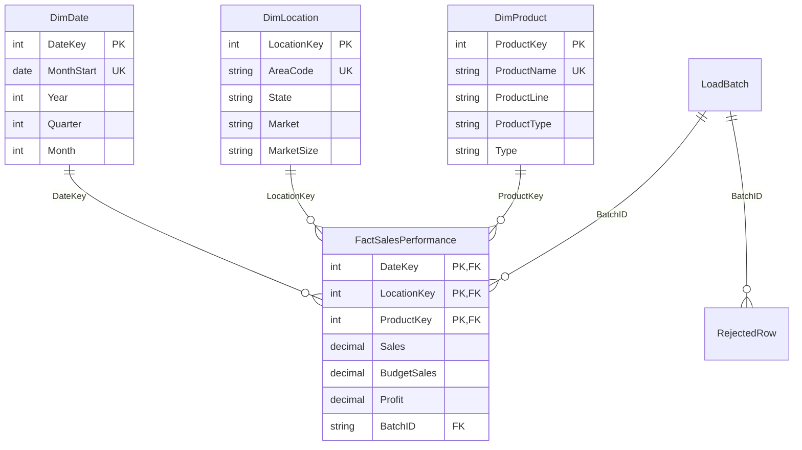

# Hợp đồng kiến trúc và dữ liệu

Luồng chung là nguồn bất biến → staging và kiểm tra → dimension/fact → mart → cube, dashboard và dự báo. `src/coffee_dw` giữ logic dùng chung; `learning` giữ bài thử biệt lập. Dữ liệu nhân tải, SCD mô phỏng và lỗi cố ý không nạp vào kho phục vụ.

## Mô hình chiều

Chọn quá trình theo dõi hiệu quả kinh doanh định kỳ; grain tháng × mã vùng × sản phẩm; ba chiều dùng chung; 11 số đo thực hiện/ngân sách. Đây là bốn quyết định Kimball. Nguồn hiện tại đã tổng hợp, không cung cấp hóa đơn, khách hàng, số ly hay giá bán.

DimDate chỉ chứa đầu tháng có trong nguồn. Location/Product dùng khóa thay thế; tên sản phẩm là khóa nghiệp vụ khả dụng của snapshot, chưa có mã sản phẩm ổn định để theo dõi đổi tên thật. Serving dimension dùng Type 1; SCD2 mô phỏng với mã P01 trong TN04 có thời gian hiệu lực riêng.

## Ánh xạ nguồn

| CSV | Thuộc tính chuẩn | Đích |
| --- | --- | --- |
| Date | MonthStart, DateKey YYYYMMDD | DimDate; Excel origin 1899-12-30, phải là đầu tháng |
| Area Code, State, Market, Market Size | AreaCode, State, Market, MarketSize | DimLocation; AreaCode là chuỗi |
| Product, Product Line, Product Type, Type | ProductName, ProductLine, ProductType, Type | DimProduct |
| Sales, Budget Sales | Sales, BudgetSales | Fact |
| Profit, Budget Profit | Profit, BudgetProfit | Fact |
| COGS, Budget COGS | COGS, BudgetCOGS | Fact |
| Margin, Budget Margin | Margin, BudgetMargin | Fact |
| Marketing, Inventory, Total Expenses | Marketing, Inventory, TotalExpenses | Fact |

SQL Server lưu DECIMAL(19,4); bản SQLite lưu số nguyên nhân 10.000 và view chia về đơn vị nguồn. Dữ liệu đưa ra pandas phục vụ hiển thị là số thực. Giữ các số âm và chênh giả thuyết kế toán; thiếu khóa, sai kiểu, trùng grain hoặc thuộc tính cha mâu thuẫn đi vào reject. SourceRow đánh số bản ghi CSV từ 2, không phải định danh giao dịch.

## Hợp đồng consumer

`warehouse.read_detail(db_path)` trả DataFrame từ `vw_Detail`: MonthStart dạng datetime; DateKey; AreaCode, State, Market, MarketSize; ProductName, ProductLine, ProductType, Type; 11 số đo; SourceRow và BatchID. SQL Server có cùng tên cột ở `mart.vw_Detail` và thêm LocationKey/ProductKey.

`vw_MarketPeriod` duy nhất theo tháng–Market; `vw_MarketProductPeriod` duy nhất theo tháng–Market–ProductName. Gap = SUM(Sales) − SUM(BudgetSales). BudgetAchievement = SUM(Sales)/SUM(BudgetSales), NULL nếu mẫu bằng 0. Không lấy trung bình tỷ lệ từng dòng. Profit margin tương tự SUM(Profit)/SUM(Sales).

Inventory là snapshot theo kỳ, chưa rõ đơn vị nguồn. Dashboard chọn kỳ cuối trong khoảng đang xem rồi cộng theo Market. Đây là quy ước minh bạch cho bài tập; cần metadata nghiệp vụ bổ sung trước khi kết luận tồn kho thực tế.

## ETL và truy vết

Batch lưu checksum SHA256, thời điểm UTC, số nguồn/hợp lệ/lỗi/chèn/sửa/giữ nguyên. Fact unique ba khóa chiều. Phát lại file hoàn tất được bỏ qua ở SQLite; SQL Server đối soát từng grain. Nguồn cùng grain nhưng sửa số tạo batch mới và UPDATE số đo trong transaction. Phát lại một file cũ đã xử lý không phải thao tác khôi phục snapshot cũ.

Không xóa fact vắng trong batch tăng dần. Nguồn này chưa có CDC hay dấu xóa; bài thử CDC/late-arriving phải công bố chính sách riêng trước khi dùng. Audit giữ raw payload để truy về dòng nguồn. Nếu load thất bại, transaction rollback; runner phải giữ traceback/log chạy ngoài DB để kiểm tra lỗi cả batch.

## Dự báo và drill-across

ForecastSales có grain `(Market, ForecastMonth, IssueMonth, ModelName, ModelVersion)`; TrainEnd < ForecastMonth. Actual kinh doanh phải GROUP BY Market–Month trước khi ghép. Chọn đúng phương pháp và kỳ phát hành để mỗi khóa mục tiêu chỉ có một dự báo. Không JOIN fact kinh doanh chi tiết với mọi phiên bản forecast rồi SUM.

Ridge fit StandardScaler riêng trên lịch sử đã biết ở từng origin; model selection dùng validation trước test. Khi thay nguồn hoặc thuật toán cần chạy lại forecast và cập nhật ModelVersion. Dashboard không huấn luyện mô hình khi mở trang.

## Ranh giới môi trường

SQLite phục vụ demo logic và kiểm tra CI. SQL Server/SSIS/SSAS là môi trường báo cáo native; cần chạy riêng. Kế hoạch truy cập, indexed view, partition elimination, logical reads và CPU SQL Server không suy ra từ SQLite. Các script benchmark dùng `bench`, không làm thay đổi star phục vụ dashboard.
