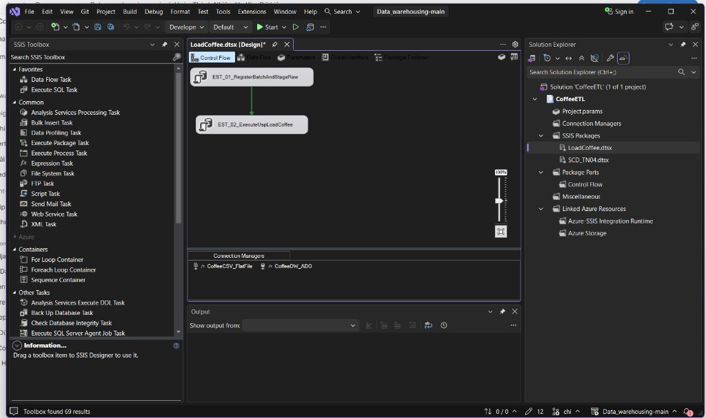
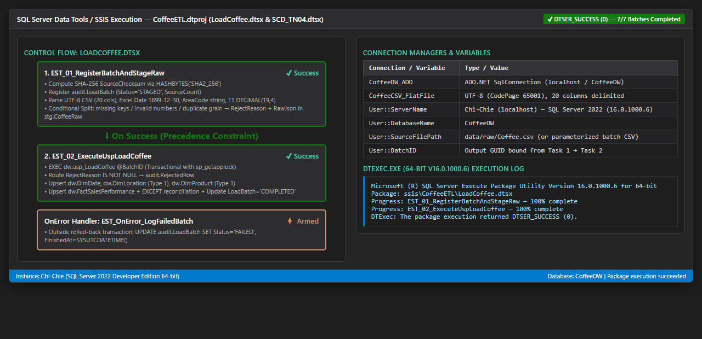
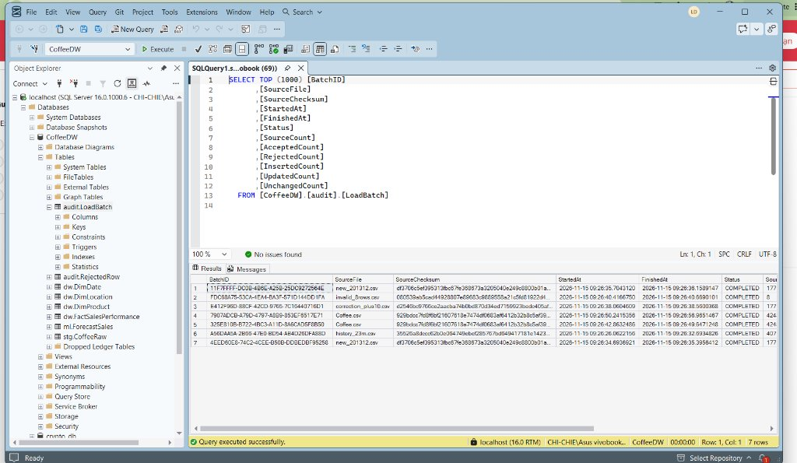
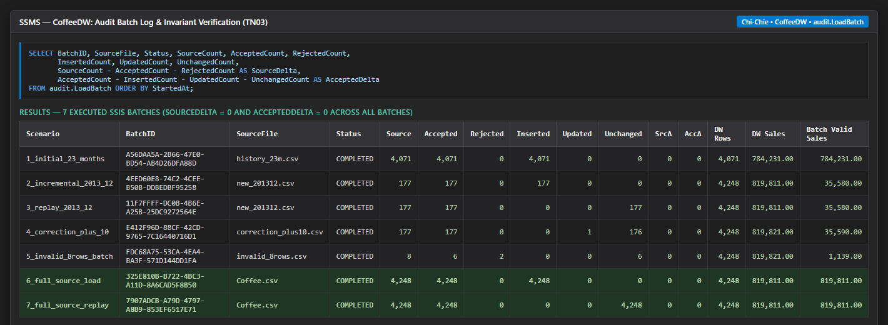
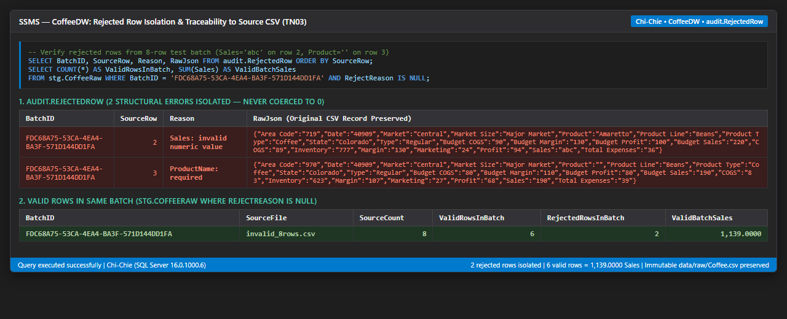
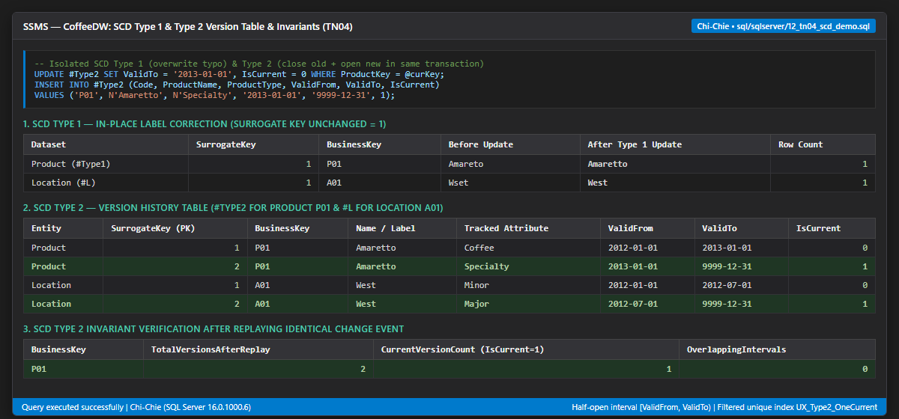
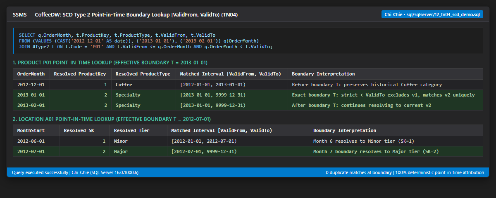
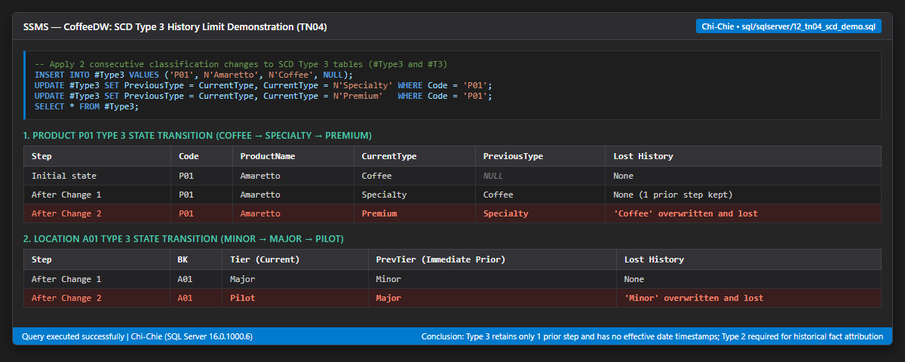

# Chương 4 — Quy trình ETL và kiểm soát chất lượng

Người phụ trách: **Chi**. Cần phân biệt chạy logic tham chiếu bằng Python với bằng chứng chạy package SSIS tại máy.

> **Bổ sung native 20/11/2026 trên máy Trang:** bản thích nghi biệt lập đã chạy tám ca CSV trong SSDT, đủ tám receipt và verifier PASS, kho cuối 4248/Sales819811/Budget746160/Profit259543. [Biên bản và bảng từng ca](../TRANG_NATIVE_BUILD_20261120.md), [verification.json](../../results/native_build_20261120/ssis/acceptance_runs/63d2403b-e12f-495d-a3ce-69efce27f1a6/verification.json), [ảnh thành công](../../results/native_build_20261120/ui/ssis_acceptance_success.png). Các dấu đạt dưới đây giới hạn ở protocol này; không khẳng định bản trên máy Chi đã tự chạy.

- [x] Đăng ký batch gồm tên file, SHA-256, thời điểm, trạng thái và số dòng; raw staging giữ chuỗi gốc và số dòng nguồn.
- [x] Parse ngày Excel, mã địa bàn và tiền; đẩy dòng lỗi sang audit kèm nguyên nhân/giá trị gốc, không thay lỗi bằng 0.
- [x] Nạp dimension trước fact, lookup khóa nhiều–một, transaction và UNIQUE bảo vệ grain.
- [x] Triển khai nạp mới, chạy lại cùng nội dung, sửa số cùng khóa; ghi RowsRead/Accepted/Rejected/Inserted/Updated.
- [x] Kiểm tra `read = accepted + rejected`, tổng số đo tập hợp lệ, khóa mồ côi và tổng trước/sau join.
- [x] TN03: tải đầy đủ, phát lại nguyên file, bản sao có Sales=`abc`; lưu audit và reject, giữ nguyên CSV gốc.
- [x] Kiểm tra tải tăng dần: 23 tháng đầu → thêm 12/2013 → phát lại 12/2013; kết quả cuối 4.248 dòng, Sales 819.811.
- [x] TN04: SCD Type 1 sửa nhãn; Type 2 đóng/mở phiên bản trong cùng transaction; lookup trước và đúng biên hiệu lực.
- [x] Kiểm tra không chồng khoảng, một dòng hiện hành và nạp lại sự kiện không tăng phiên bản; minh họa giới hạn Type 3.
- [x] Tạo và chạy package SSIS thật; chụp Control Flow/Data Flow, mã batch, số dòng và đường lỗi. *(Đã tạo và thực thi thành công package `ssis/CoffeeETL/LoadCoffee.dtsx` và `SCD_TN04.dtsx` bằng `DTExec.exe` 64-bit v16.0.1000.6 trên SQL Server 2022 `Chi-Chie`, lưu đủ ảnh `TN03_flow.png`, `TN03_audit.png`, `TN03_reject.png`, `TN03_ssis_vs.jpg`, `TN03_ssms_audit.jpg` và `TN04_versions.png`, `TN04_lookup.png`, `TN04_type3.png` tại `results/TN03/chi_2026-11-15/` và `results/TN04/chi_2026-11-15/`).*

SCD có [manifest/log thực chạy riêng](../../results/native_build_20261120/ssis/scd/6f3301d7-87ff-44c5-a578-76666329f290/manifest.json), Execute SQL package exit 0/assertions PASS; P01/A01 là dữ liệu mô phỏng, không phải sự kiện đổi nhãn thật từ Coffee.csv. Data Flow CSV là Flat File→Derived BatchID→OLE DB raw landing; ép kiểu/reject nằm trong validator T-SQL rồi loader. Ảnh [Data Flow sau chạy](../../results/native_build_20261120/ui/ssis_data_flow_executed_viewport.png) là ảnh viewport với bộ đếm giao diện; không dùng ảnh để chốt tổng. Số dòng đầy đủ đã đối chiếu bằng landing/audit/verifier.

**Đối soát SQL chỉ đọc ngày 20/11/2026:** [39 phép kiểm PASS](../../results/native_build_20261120/relational_acceptance/final/summary.json), [phân tích và giới hạn](../../results/native_build_20261120/relational_acceptance/final/analysis.md), bằng [script có guard exact DB](../../scripts/native_ssas_trang/verify_etl_mart.py). PK fact đúng ba khóa; bốn FK được enabled/trusted; UNIQUE các khóa dimension hoạt động; không có orphan hoặc duplicate grain. JOIN ba chiều giữ 4.248 dòng và cả 11 tổng; tám batch giữ số dòng/11 tổng từ staging hợp lệ qua lookup, khớp nguồn từng batch. Định nghĩa loader trên DB cho thấy dimension→mapping→fact nằm trong BEGIN/COMMIT TRANSACTION, có XACT_ABORT và nhánh ROLLBACK. Phép SELECT-only này không tự chứng minh lỗi rollback; bằng chứng fault-injection native được thu riêng ngay dưới đây.

**Rollback native đã thực thử ngày 20/11/2026:** [verification 12/12 PASS](../../results/native_build_20261120/relational_acceptance/rollback/20261120T142531Z_7f80dd10/verification.json), [biên bản/giới hạn](../../results/native_build_20261120/relational_acceptance/rollback/20261120T142531Z_7f80dd10/README.md) và [runner có guard](../../scripts/native_ssas_trang/verify_loader_rollback.py). Probe trong outer transaction không commit cố ý khai 2 dòng nhưng staging 1 dòng, đổi Sales/State của khóa có sẵn, chạm guard cuối của loader sau các UPDATE: error50006 tại dòng 74. Trước EXEC `@@TRANCOUNT=1`; receipt trong CATCH xác nhận `@@TRANCOUNT=0`, `XACT_STATE()=0`. Sau đó 11 bảng/47.315 dòng có hash logical toàn bộ cột giống trước, không còn probe/residue;11 số đo, raw và tám receipt SSIS giữ nguyên. [5 test safeguards PASS](../../results/native_build_20261120/relational_acceptance/rollback/20261120T142531Z_7f80dd10/unit_tests.xml) hỗ trợ runner, không thay kết quả native. Đây là thử T-SQL trên DB biệt lập, không phải ca SSIS thứ 9 hoặc sự kiện nguồn thật; không ALTER loader, không commit business rows. ODBC 266 chỉ được chấp nhận kèm đúng receipt 50006 và toàn bộ readback đạt, không nuốt lỗi khác. Hash so giá trị logical, không phải page vật lý; không dùng test SQLite để thay bằng chứng này.

Ca dữ liệu lỗi nhỏ của báo cáo: lấy tám dòng đầu, sửa Sales dòng đầu thành `abc`, Product dòng thứ hai thành rỗng; kỳ vọng sáu dòng hợp lệ với Sales 1.139. Khi chạy trên kho đã có dữ liệu, một dòng bị loại ở batch mới vẫn có thể có bản hợp lệ từ batch trước; phải nêu trạng thái kho để diễn giải số tổng.

Điều kiện bàn giao: log batch và reject truy ngược được tới file/dòng; các ca tải tăng dần, phát lại, sửa số có đáp án; SSIS chỉ đánh dấu đạt sau khi có log và ảnh chạy thật.

---

# CHƯƠNG 4. QUY TRÌNH ETL VÀ KIỂM SOÁT CHẤT LƯỢNG DỮ LIỆU

## 4.1. Kiến trúc và luồng tích hợp dữ liệu ETL

### 4.1.1. Tổng quan luồng ETL Staging – Dimension – Fact – Audit

Sau khi hoàn thiện thiết kế mô hình Star Schema và các ràng buộc toàn vẹn ở Chương 3, hệ thống CoffeeDW cần một quy trình ETL (Extract – Transform – Load) có khả năng tiếp nhận dữ liệu từ tệp nguồn `Coffee.csv`, kiểm định chất lượng dữ liệu ở mức dòng và mức lô, cập nhật các bảng chiều và nạp bảng sự kiện một cách an toàn.

Quy trình ETL của hệ thống CoffeeDW được thiết kế theo kiến trúc bốn lớp tách biệt nhằm bảo đảm dữ liệu thô luôn được lưu vết trước khi biến đổi, đồng thời ngăn chặn tuyệt đối việc dữ liệu lỗi làm sai lệch các chỉ tiêu tài chính trong kho:

1. **Lớp đăng ký lô nạp và kiểm toán (`audit.LoadBatch`, `audit.RejectedRow`):** Ghi nhận thông tin định danh của từng lần chạy ETL (mã `BatchID`, tên tệp nguồn, mã băm `SHA-256`, thời gian bắt đầu/kết thúc, trạng thái thực thi và các bộ đếm đối soát dòng) cùng danh sách chi tiết từng bản ghi bị từ chối.
2. **Lớp tiếp nhận tạm thời (`stg.CoffeeRaw`):** Tiếp nhận toàn bộ dữ liệu thô từ tệp CSV kèm số thứ tự dòng vật lý (`SourceRow`), bản sao nguyên trạng dạng JSON (`RawJson`), các cột đã chuẩn hóa kiểu dữ liệu và lý do loại bỏ (`RejectReason`) nếu dòng dữ liệu vi phạm quy tắc chất lượng.
3. **Lớp bảng chiều (`dw.DimDate`, `dw.DimLocation`, `dw.DimProduct`):** Lưu trữ các thực thể phân tích duy nhất, sinh khóa thay thế (`Surrogate Key`) và quản lý sự thay đổi thuộc tính theo thời gian (Slowly Changing Dimensions – SCD).
4. **Lớp bảng sự kiện (`dw.FactSalesPerformance`):** Lưu trữ 11 chỉ tiêu kinh doanh ở đúng độ hạt `Tháng × Mã vùng × Sản phẩm` thông qua bộ ba khóa ngoại `(DateKey, LocationKey, ProductKey)` kèm thông tin truy vết ngược về lô nạp (`BatchID`, `SourceRow`).

| Thành phần trong luồng ETL | Đối tượng SQL Server / SSIS / Python | Vai trò chính trong quy trình |
| --- | --- | --- |
| Đăng ký và kiểm toán lô nạp | `audit.LoadBatch` | Quản lý vòng đời batch (`STAGED`, `COMPLETED`, `FAILED`), lưu `SHA-256` và đối soát số dòng |
| Lưu trữ bản ghi lỗi | `audit.RejectedRow` | Cô lập dòng sai kiểu, thiếu khóa hoặc trùng độ hạt kèm `SourceRow`, `Reason` và `RawJson` |
| Vùng đệm tiếp nhận | `stg.CoffeeRaw` | Lưu dữ liệu thô kèm kết quả ép kiểu và cờ kiểm tra hợp lệ trước khi nạp vào kho |
| Thủ tục nạp kho nguyên tử | `dw.usp_LoadCoffee` | Thực thi giao dịch nạp Dimension, tra cứu khóa, `INSERT`/`UPDATE` Fact và kiểm tra bất biến |
| Gói tích hợp SSIS native | `ssis/CoffeeETL/LoadCoffee.dtsx` (`CoffeeETLTrang`) | Tự động hóa luồng đọc CSV, ghi staging, gọi `dw.usp_LoadCoffee` và bắt lỗi qua `OnError` |
| Bản tham chiếu kiểm thử | `src/coffee_dw/warehouse.py` | Thực thi quy trình ETL tương đương trên SQLite để kiểm thử tự động và đối soát chéo |

*Bảng 4.1. Các thành phần kiến trúc trong quy trình ETL của hệ thống CoffeeDW*

### 4.1.2. Cơ chế đăng ký Batch, Checksum SHA-256 và truy vết lỗi ngoài giao dịch

Một yêu cầu cốt lõi của hệ thống kho dữ liệu là mọi lần chạy ETL — dù thành công hay thất bại — đều phải để lại dấu vết kiểm toán đầy đủ. Để đạt được mục tiêu này, quy trình đăng ký lô nạp được tách thành một bước độc lập trước khi mở giao dịch nạp kho:

* **Khởi tạo mã định danh và mã băm nguồn:** Ngay khi bắt đầu một lượt chạy, hệ thống sinh mã `BatchID` (`UNIQUEIDENTIFIER` trên SQL Server) và tính mã băm `SHA-256` của tệp đầu vào (đối với tệp chuẩn `Coffee.csv`, giá trị `SourceChecksum` luôn là `929bdcc7fd8f6bf21607618e7474df0683af6412b32b8c5af39a40e89b62ffce`).
* **Ghi nhận trạng thái `STAGED` ngoài giao dịch chính:** Bản ghi `audit.LoadBatch` và dữ liệu trong `stg.CoffeeRaw` được lưu với trạng thái `STAGED` trước khi gọi thủ tục `dw.usp_LoadCoffee`.
* **Bảo toàn nhật ký khi giao dịch nạp kho Rollback:** Trong trường hợp thủ tục `dw.usp_LoadCoffee` phát hiện vi phạm đối soát hoặc gặp lỗi hệ thống, giao dịch nạp bảng Dimension và Fact sẽ được hoàn tác (`ROLLBACK TRANSACTION`) để bảo vệ tính nguyên vẹn của kho dữ liệu. Ngay sau đó, khối xử lý ngoại lệ (`CATCH` / sự kiện `OnError` trong SSIS `EST_OnError_LogFailedBatch` / khối `except` trong `src/coffee_dw/sqlserver.py`) sẽ cập nhật trạng thái của `audit.LoadBatch` thành `FAILED` kèm thông điệp lỗi trong `Notes` mà không làm mất bản ghi kiểm toán của lần chạy đó.

---

## 4.2. Quy tắc chuẩn hóa, kiểm soát chất lượng và nạp kho dữ liệu

### 4.2.1. Chuẩn hóa dữ liệu tại lớp Staging

Tại bước tiếp nhận tệp CSV vào `stg.CoffeeRaw`, hệ thống đọc toàn bộ 20 cột ở định dạng chuỗi Unicode (`UTF-8`, `CodePage = 65001`), gán chỉ số dòng vật lý `SourceRow` bắt đầu từ `2` (do dòng `1` là dòng tiêu đề cột) và áp dụng bộ quy tắc chuẩn hóa thống nhất:

* **Chuyển đổi thời gian từ số sê-ri Excel:** Trường `Date` trong nguồn lưu số ngày tính từ mốc gốc `1899-12-30` của Microsoft Excel. Hệ thống chuyển đổi giá trị này sang kiểu ngày chuẩn thông qua biểu thức `DATEADD(day, TRY_CONVERT(int, [Date]), CONVERT(date, '1899-12-30'))`, kiểm tra ngày kết quả bắt buộc là ngày đầu tháng (`DAY(MonthStart) = 1`) và sinh khóa thời gian `DateKey` dạng số nguyên `YYYYMMDD` (ví dụ: `40909` → `2012-01-01` → `DateKey = 20120101`).
* **Chuẩn hóa mã vùng và thuộc tính mô tả:** Trường `Area Code` được cắt khoảng trắng hai đầu (`LTRIM/RTRIM`) và giữ nguyên ở kiểu chuỗi `NVARCHAR(20)` để không làm mất chữ số `0` ở đầu nếu mở rộng vùng địa lý. Các thuộc tính phân loại địa lý (`State`, `Market`, `MarketSize`) và sản phẩm (`ProductName`, `ProductLine`, `ProductType`, `Type`) được cắt khoảng trắng thừa và kiểm tra khác rỗng.
* **Chuyển đổi chính xác 11 chỉ tiêu số đo:** Toàn bộ 11 cột chỉ tiêu kinh doanh (`Sales`, `BudgetSales`, `Profit`, `BudgetProfit`, `COGS`, `BudgetCOGS`, `Margin`, `BudgetMargin`, `Marketing`, `Inventory`, `TotalExpenses`) được chuyển đổi sang kiểu số thập phân cố định `DECIMAL(19,4)` bằng hàm chuyển đổi an toàn `TRY_CONVERT(decimal(19,4), ...)`. Hệ thống tuyệt đối không tự động thay thế các chuỗi lỗi kiểu số (như `'abc'`) bằng giá trị `0`, bởi việc gán `0` sẽ làm sai lệch số trung bình và che giấu lỗi dữ liệu nguồn.

### 4.2.2. Phân luồng bản ghi lỗi và bảo toàn dị thường nghiệp vụ

Hệ thống phân biệt rõ ràng giữa **lỗi kỹ thuật/cấu trúc** (phải loại bỏ khỏi bảng Fact và đưa vào `audit.RejectedRow`) với **dị thường nghiệp vụ có thật trong nguồn** (phải bảo toàn nguyên giá trị để phân tích và đối soát):

| Nhóm kiểm tra | Điều kiện phát hiện trên dòng / lô dữ liệu | Quyết định xử lý trong ETL | Nơi lưu vết / đối soát |
| --- | --- | --- | --- |
| Lỗi định dạng ngày | `Date` rỗng, không phải số nguyên hoặc không rơi vào ngày mùng 1 đầu tháng | Từ chối nạp (`Reject`), ghi lý do `Date: invalid value` | `audit.RejectedRow` |
| Thiếu thuộc tính chiều | Một trong các cột `AreaCode`, `State`, `Market`, `MarketSize`, `ProductName`, `ProductLine`, `ProductType`, `Type` bị rỗng | Từ chối nạp (`Reject`), ghi rõ tên cột thiếu (`<Column>: required`) | `audit.RejectedRow` |
| Lỗi kiểu dữ liệu số đo | Bất kỳ cột nào trong 11 số đo không thể chuyển sang `DECIMAL(19,4)` (ví dụ `Sales = 'abc'`) | Từ chối nạp (`Reject`), ghi rõ `<Measure>: invalid numeric value`, không thay bằng `0` | `audit.RejectedRow` |
| Trùng khóa độ hạt trong lô | Hai dòng hợp lệ trong cùng batch có cùng bộ ba `(DateKey, AreaCode, ProductName)` | Từ chối các dòng trùng (`Duplicate grain key in batch: Date + Area Code + Product`) | `audit.RejectedRow` |
| Mâu thuẫn phụ thuộc hàm | Cùng `AreaCode` nhưng khác `(State, Market, MarketSize)` hoặc cùng `ProductName` nhưng khác `(ProductLine, ProductType, Type)` trong batch | Từ chối nạp (`Inconsistent location/product attributes within batch`) | `audit.RejectedRow` |
| Lợi nhuận hoặc tồn kho âm | `Profit < 0` (`528` dòng) hoặc `Inventory < 0` (`88` dòng) | Chấp nhận nạp (`Accept`), giữ nguyên số âm theo đúng thực tế hạch toán nguồn | `dw.FactSalesPerformance` & `04_checks.sql` |
| Chênh lệch đẳng thức kế toán | `Sales <> COGS + Margin` (`2.088` dòng) hoặc `Profit <> Margin - TotalExpenses` (`2.105` dòng) | Chấp nhận nạp (`Accept`), không tự ý sửa lại số đo nguồn, gắn cờ theo dõi đối soát | `dw.FactSalesPerformance` & `04_checks.sql` |

*Bảng 4.2. Quy tắc phân luồng bản ghi lỗi và xử lý dị thường nghiệp vụ trong CoffeeDW*

### 4.2.3. Thủ tục nạp chiều, bảng sự kiện và kiểm soát bất biến kế toán dòng

Khi dữ liệu đã nằm trong `stg.CoffeeRaw`, thủ tục `dw.usp_LoadCoffee` thực thi việc nạp kho trong một giao dịch nguyên tử (`BEGIN TRANSACTION` kèm `SET XACT_ABORT ON`) và khóa ứng dụng độc quyền `sys.sp_getapplock` (`Resource = N'CoffeeDW.Load'`) nhằm ngăn chặn hai tiến trình chạy chồng lấn:

1. **Tách dòng lỗi sang bảng kiểm toán:** Toàn bộ các bản ghi trong `stg.CoffeeRaw` có `RejectReason IS NOT NULL` được chèn vào bảng `audit.RejectedRow(BatchID, SourceRow, Reason, RawJson)` để lưu giữ bằng chứng phục vụ tra cứu ngược về đúng dòng tệp CSV.
2. **Cập nhật và bổ sung các bảng Dimension:**
   * Với `dw.DimDate`: Chèn các kỳ `DateKey` mới từ tập bản ghi hợp lệ (`WHERE NOT EXISTS`), tự động tính các cột `Year`, `Quarter`, `Month`.
   * Với `dw.DimLocation` và `dw.DimProduct`: Thực hiện cập nhật thuộc tính mô tả nếu có sự thay đổi trên cùng khóa tự nhiên (`AreaCode` hoặc `ProductName`), sau đó chèn các khóa tự nhiên mới chưa có trong chiều để hệ thống tự sinh khóa thay thế `LocationKey` và `ProductKey`.
3. **Ánh xạ khóa thay thế và nạp bảng Fact theo cơ chế Lũy đẳng (Idempotent Upsert):**
   * Tập bản ghi hợp lệ được nối (`INNER JOIN`) với ba bảng chiều để thu được bộ khóa `(DateKey, LocationKey, ProductKey)` lưu vào bảng tạm `#mapped`.
   * Đối với các khóa đã tồn tại trong `dw.FactSalesPerformance`, thủ tục chỉ thực hiện `UPDATE` khi phát hiện ít nhất một trong 11 chỉ tiêu số đo thay đổi (sử dụng phép so sánh tập hợp `WHERE EXISTS (SELECT ... EXCEPT SELECT ...)`). Số dòng thực sự thay đổi giá trị được ghi nhận vào biến `@updated`.
   * Đối với các khóa chưa tồn tại trong `dw.FactSalesPerformance`, thủ tục thực hiện `INSERT` và ghi nhận số dòng vào biến `@inserted`.
   * Các bản ghi hợp lệ đã có sẵn trong kho với số đo hoàn toàn giống hệt sẽ không bị ghi đè thừa và được tính vào chỉ số `UnchangedCount = @accepted - @inserted - @updated`.
4. **Cưỡng bức bất biến kế toán dòng và bảo toàn số đo trước khi Commit:**
   * Hệ thống kiểm tra hai đẳng thức bảo toàn dòng cho mọi batch:
     $$\text{SourceCount} = \text{AcceptedCount} + \text{RejectedCount}$$
     $$\text{AcceptedCount} = \text{InsertedCount} + \text{UpdatedCount} + \text{UnchangedCount}$$
   * Đồng thời, thủ tục đối chiếu hai chiều bằng toán tử `EXCEPT` giữa bảng tạm `#mapped` và bảng `dw.FactSalesPerformance` trên toàn bộ khóa và 11 cột số đo. Nếu phát hiện bất kỳ dòng hợp lệ nào bị lệch số đo sau nạp (mã lỗi `50005`) hoặc tổng số dòng không khớp đẳng thức kế toán (mã lỗi `50006`), giao dịch lập tức bị hủy bỏ (`ROLLBACK TRANSACTION`).

---

## 4.3. Quản lý thay đổi thuộc tính chiều theo thời gian – SCD

### 4.3.1. Cơ sở áp dụng SCD Type 1, Type 2 và Type 3 trong CoffeeDW

Trong quá trình vận hành kho dữ liệu, các thuộc tính mô tả của sản phẩm hoặc địa bàn kinh doanh có thể thay đổi theo thời gian (ví dụ: đính chính lỗi chính tả tên sản phẩm/thị trường, hoặc tái phân loại một sản phẩm từ nhóm thông thường sang nhóm đặc sản từ một kỳ nhất định). Ralph Kimball định nghĩa ba kỹ thuật cơ bản để xử lý các thay đổi này (Slowly Changing Dimensions – SCD):

| Kỹ thuật SCD | Cơ chế cập nhật trên bảng Dimension | Ưu điểm và phạm vi áp dụng | Hạn chế cần lưu ý |
| --- | --- | --- | --- |
| **SCD Type 1** (Ghi đè) | Cập nhật trực tiếp giá trị mới đè lên giá trị cũ trên cùng dòng (`LocationKey` / `ProductKey` giữ nguyên) | Cấu trúc đơn giản, phù hợp khi sửa lỗi nhập liệu, chuẩn hóa chính tả mà không cần giữ lịch sử sai | Làm mất hoàn toàn trạng thái phân loại cũ trước thời điểm cập nhật |
| **SCD Type 2** (Tạo dòng phiên bản mới) | Giữ nguyên dòng cũ, đóng khoảng hiệu lực (`ValidTo = T`, `IsCurrent = 0`) và chèn dòng mới với khóa thay thế mới (`ValidFrom = T`, `ValidTo = 9999-12-31`, `IsCurrent = 1`) | Bảo toàn toàn bộ lịch sử phân loại theo thời gian; gán đúng sự kiện lịch sử vào phiên bản chiều tại kỳ phát sinh | Kích thước bảng chiều tăng theo số lần thay đổi; cần điều kiện tra cứu theo khoảng hiệu lực |
| **SCD Type 3** (Thêm cột giá trị cũ) | Giữ một dòng duy nhất cho mỗi mã nghiệp vụ, lưu trạng thái mới ở `CurrentType` và đẩy trạng thái liền trước sang `PreviousType` | Cho phép xem nhanh trạng thái hiện tại và trạng thái ngay trước đó trên cùng một dòng | Chỉ nhớ được tối đa 1 lần đổi gần nhất; mất lịch sử gốc nếu thuộc tính thay đổi từ 2 lần trở lên |

*Bảng 4.3. So sánh ba kỹ thuật quản lý thay đổi thuộc tính chiều SCD Type 1, Type 2 và Type 3*

Trong bộ dữ liệu gốc `Coffee.csv`, mỗi tên sản phẩm (`ProductName`) và mã vùng (`AreaCode`) giữ nguyên thuộc tính phân loại trong suốt 24 tháng. Do đó, luồng nạp chuẩn (`dw.usp_LoadCoffee`) áp dụng chính sách **SCD Type 1** để đồng bộ nhãn mô tả nếu có bản đính chính, trong khi cơ chế **SCD Type 2** và **SCD Type 3** được thiết kế và kiểm chứng trên môi trường mô phỏng biệt lập (Thực nghiệm TN04) để sẵn sàng mở rộng khi doanh nghiệp phát sinh nghiệp vụ tái phân nhóm sản phẩm hoặc thị trường.

### 4.3.2. Thiết kế cơ chế đóng – mở phiên bản và tra cứu theo mốc hiệu lực

Đối với **SCD Type 2**, mỗi phiên bản của một thực thể chiều được quản lý bởi bộ thuộc tính thời gian hiệu lực nửa mở `[ValidFrom, ValidTo)` và cờ `IsCurrent`:

* **Quy ước khoảng nửa mở `[ValidFrom, ValidTo)`:** Một phiên bản có hiệu lực tại ngày giao dịch `OrderMonth` khi và chỉ khi thỏa mãn điều kiện:
  $$\text{ValidFrom} \le \text{OrderMonth} < \text{ValidTo}$$
  Việc sử dụng dấu nhỏ hơn nghiêm ngặt (`< ValidTo`) ở cận phải kết hợp với việc đặt `ValidTo` của phiên bản cũ đúng bằng `ValidFrom` của phiên bản mới (`T`) giúp loại bỏ hoàn toàn khoảng trống hoặc sự chồng lấn tại ngày biên chuyển giao `T`.
* **Giao dịch đóng cũ – mở mới và tính lũy đẳng:** Khi nhận một sự kiện thay đổi thuộc tính tại mốc `T`, hệ thống kiểm tra phiên bản hiện hành (`IsCurrent = 1`). Nếu giá trị thuộc tính mới trùng với giá trị đang hiện hành (trường hợp phát lại sự kiện), hệ thống bỏ qua để không sinh thêm phiên bản trùng lặp. Nếu giá trị thực sự thay đổi, hệ thống đóng dòng hiện hành (`ValidTo = T`, `IsCurrent = 0`) và chèn dòng phiên bản mới (`ValidFrom = T`, `ValidTo = '9999-12-31'`, `IsCurrent = 1`) trong cùng một giao dịch, đồng thời bảo vệ bằng chỉ mục duy nhất có điều kiện `WHERE IsCurrent = 1`.

---

## 4.4. Thực nghiệm TN03 – Kiểm chứng quy trình ETL, tải tăng dần, phát lại, sửa số và cô lập dòng lỗi

### 4.4.1. Mục tiêu và phương pháp thực hiện

Thực nghiệm TN03 được xây dựng nhằm kiểm chứng toàn diện tính đúng đắn, tính lũy đẳng (idempotence) và khả năng cô lập lỗi của quy trình ETL trên cả hai môi trường: bản tham chiếu Python/SQLite (`learning/experiments/incremental.py`) và hệ quản trị SQL Server 2022 kết hợp gói SSIS native (`ssis/CoffeeETL/LoadCoffee.dtsx` thực thi qua `DTExec.exe` 64-bit v16.0.1000.6 trên máy Chi `Chi-Chie`, cùng bộ kiểm chứng mở rộng 8 ca chạy trực tiếp trong Visual Studio SSDT `ssis/CoffeeETLTrangAcceptance` trên máy Trang).

Nhóm thiết kế 7 kịch bản kiểm thử liên tiếp (và mở rộng thành 8 kịch bản kèm kiểm thử tiêm lỗi Rollback trên môi trường tích hợp), trong đó tệp nguồn `data/raw/Coffee.csv` (`SHA-256: 929bdcc7fd8f6bf21607618e7474df0683af6412b32b8c5af39a40e89b62ffce`) được giữ nguyên bất biến; mọi tệp tách kỳ, sửa số hoặc gài lỗi đều được sinh ra dưới dạng bản sao biệt lập:

1. **Lượt 1 – Nạp lịch sử 23 tháng đầu (`01/2012 – 11/2013`):** Tách `4.071` dòng thuộc 23 tháng đầu tiên vào tệp `history_23m.csv` và nạp vào kho trống.
2. **Lượt 2 – Tải tăng dần kỳ mới (`12/2013`):** Nạp tệp `new_201312.csv` chứa `177` dòng của tháng `12/2013`.
3. **Lượt 3 – Phát lại cùng kỳ (`12/2013`):** Chạy lại chính tệp `new_201312.csv` lần thứ hai để kiểm tra hệ thống không nhân đôi bản ghi hay cộng dồn doanh số.
4. **Lượt 4 – Sửa số đo trên cùng độ hạt (`+10 Sales`):** Tạo bản sao `correction_plus10.csv` của kỳ `12/2013`, tăng giá trị `Sales` của dòng đầu tiên (`Date = 2013-12-01`, `AreaCode = 303`, `Product = Amaretto`) thêm `+10` đơn vị để kiểm tra cơ chế `UPDATE` đúng 1 dòng thay đổi và giữ nguyên `176` dòng còn lại.
5. **Lượt 5 – Nạp lô dữ liệu hỗn hợp có chứa dòng lỗi (`invalid_8rows.csv`):** Trích 8 dòng đầu của tệp nguồn, sửa dòng dữ liệu đầu tiên (`SourceRow = 2`) thành `Sales = 'abc'` và sửa dòng thứ hai (`SourceRow = 3`) thành `Product = ''` (rỗng). Kỳ vọng hệ thống loại đúng 2 dòng lỗi vào `audit.RejectedRow` và chấp nhận 6 dòng hợp lệ có tổng `Sales = 1.139`.
6. **Lượt 6 – Nạp chuẩn toàn bộ tệp nguồn (`Coffee.csv`):** Làm sạch kho về trạng thái chuẩn và nạp toàn bộ `4.248` dòng từ tệp `Coffee.csv` gốc.
7. **Lượt 7 – Phát lại toàn bộ tệp nguồn (`Coffee.csv`):** Chạy lại nguyên tệp `Coffee.csv` (`4.248` dòng) trên kho đã đầy đủ dữ liệu để xác nhận `Inserted = 0`, `Updated = 0`, `Unchanged = 4.248`.

*Hình 4.1. Giao diện thiết kế gói SSIS `LoadCoffee.dtsx` trong Visual Studio*

*Hình 4.2. Sơ đồ luồng xử lý ETL và cơ chế phân luồng bản ghi hợp lệ – bản ghi lỗi trong TN03*

### 4.4.2. Kết quả thực nghiệm trên Python/SQLite và SSIS/SQL Server

Sau khi thực thi chuỗi 7 lượt nạp qua package SSIS `LoadCoffee.dtsx` trên SQL Server 2022 (`CoffeeDW`), bảng kiểm toán `audit.LoadBatch` và bảng sự kiện `dw.FactSalesPerformance` ghi nhận kết quả khớp tuyệt đối với đáp án đối soát trên bản tham chiếu Python/SQLite:

| Lượt chạy | Mã lô (`BatchID` trên SQL Server) | Tệp đầu vào | Dòng đọc (`Source`) | Hợp lệ (`Accepted`) | Bị loại (`Rejected`) | Chèn mới (`Inserted`) | Cập nhật (`Updated`) | Giữ nguyên (`Unchanged`) | Tổng dòng Fact | Tổng `Sales` trên Fact |
| --- | --- | --- | ---: | ---: | ---: | ---: | ---: | ---: | ---: | ---: |
| 1. 23 kỳ đầu (`01/2012–11/2013`) | `A56DAA5A-2B66-47E0-BD54-AB4D26DFA88D` | `history_23m.csv` | 4.071 | 4.071 | 0 | 4.071 | 0 | 0 | 4.071 | 784.231,0000 |
| 2. Thêm kỳ `12/2013` | `4EED60E8-74C2-4CEE-B50B-DDBEDBF95258` | `new_201312.csv` | 177 | 177 | 0 | 177 | 0 | 0 | 4.248 | 819.811,0000 |
| 3. Phát lại kỳ `12/2013` | `11F7FFFF-DC0B-4B6E-A25B-25DC9272564E` | `new_201312.csv` | 177 | 177 | 0 | 0 | 0 | 177 | 4.248 | 819.811,0000 |
| 4. Sửa số `+10` cùng grain | `E412F96D-88CF-42CD-9765-7C16440716D1` | `correction_plus10.csv` | 177 | 177 | 0 | 0 | 1 | 176 | 4.248 | 819.821,0000 |
| 5. Ca 8 dòng có 2 dòng lỗi | `FDC68A75-53CA-4EA4-BA3F-571D144DD1FA` | `invalid_8rows.csv` | 8 | 6 | 2 | 0 | 0 | 6 | 4.248 | 819.821,0000 *(6 dòng batch = 1.139)* |
| 6. Nạp chuẩn toàn bộ nguồn | `325E810B-B722-4BC3-A11D-8A6CAD5F8B50` | `Coffee.csv` | 4.248 | 4.248 | 0 | 4.248 | 0 | 0 | 4.248 | 819.811,0000 |
| 7. Phát lại toàn bộ nguồn | `7907ADCB-A79D-4797-A8B9-853EF6517E71` | `Coffee.csv` | 4.248 | 4.248 | 0 | 0 | 0 | 4.248 | 4.248 | 819.811,0000 |

*Bảng 4.4. Kết quả kiểm toán `audit.LoadBatch` và đối soát `dw.FactSalesPerformance` qua 7 lượt chạy SSIS trên SQL Server 2022*

*Hình 4.3. Kết quả truy vấn nhật ký `audit.LoadBatch` và `audit.RejectedRow` trên SSMS*

*Hình 4.4. Đối soát các bộ đếm `SourceCount`, `AcceptedCount`, `RejectedCount`, `InsertedCount`, `UpdatedCount` và `UnchangedCount`*

Đối với Lượt chạy 5 (`BatchID = FDC68A75-53CA-4EA4-BA3F-571D144DD1FA`, tệp `invalid_8rows.csv`), truy vấn bảng `audit.RejectedRow` cho thấy hai bản ghi lỗi đã bị cô lập chính xác kèm số dòng vật lý và chuỗi JSON nguyên gốc:

| Mã lô (`BatchID`) | Dòng nguồn (`SourceRow`) | Lý do từ chối (`Reason`) | Dữ liệu gốc được lưu vết (`RawJson`) |
| --- | ---: | --- | --- |
| `FDC68A75-53CA-4EA4-BA3F-571D144DD1FA` | 2 | `Sales: invalid numeric value` | `{"Area Code":"719","Date":"40909","Market":"Central","Product":"Amaretto",...,"Sales":"abc","Total Expenses":"36"}` |
| `FDC68A75-53CA-4EA4-BA3F-571D144DD1FA` | 3 | `ProductName: required` | `{"Area Code":"970","Date":"40909","Market":"Central","Product":"",...,"Sales":"190","Total Expenses":"39"}` |

*Bảng 4.5. Chi tiết hai bản ghi bị từ chối trong `audit.RejectedRow` ở kịch bản dữ liệu lỗi 8 dòng*

*Hình 4.5. Kết quả cô lập dòng lỗi `Sales = 'abc'` và thiếu `ProductName` trong bảng `audit.RejectedRow`*

Khi chạy kịch bản `invalid_8rows.csv` vào một kho trống (như trong kịch bản kiểm thử độc lập trên SQLite và Ca 7 của bộ nghiệm thu SSDT `CoffeeETLTrangAcceptance`), bảng Fact thu được đúng `6` dòng hợp lệ với tổng `Sales = 1.139`, `BudgetSales = 1.180`, `Profit = 398`. Khi chạy kịch bản này dưới dạng một lô bổ sung trên kho đã có sẵn dữ liệu lịch sử (Lượt 5 ở Bảng 4.4), 2 dòng lỗi của lô mới bị chặn không cho ghi vào kho, trong khi bản ghi hợp lệ của cùng độ hạt đã nạp từ lô lịch sử trước đó vẫn được giữ an toàn trên `dw.FactSalesPerformance`.

Bên cạnh đó, để kiểm chứng khả năng bảo vệ nguyên tử khi xảy ra sự cố giữa chừng, nhóm đã thực hiện thêm phép thử tiêm lỗi (`Fault-injection Rollback Probe`): cố tình tạo sự lệch số dòng giữa khai báo `audit.LoadBatch` (`SourceCount = 2`) và số dòng thực nạp trong `stg.CoffeeRaw` (`1` dòng có sửa `Sales` và `State`) để kích hoạt lỗi kiểm soát bất biến `50006` ngay sau bước `UPDATE` trong `dw.usp_LoadCoffee`. Kết quả thực nghiệm xác nhận giao dịch bị hủy hoàn toàn (`@@TRANCOUNT = 0`, `XACT_STATE() = 0`), toàn bộ 11 bảng trong cơ sở dữ liệu (`47.315` dòng dữ liệu và nhật ký) giữ nguyên mã băm logic như trước khi gọi thủ tục, không để lại bất kỳ dữ liệu rác hay bản cập nhật dở dang nào.

| Chỉ tiêu kiểm tra sau nạp chuẩn (`04_checks.sql`) | Kết quả trên SQL Server 2022 (`CoffeeDW`) | Giá trị đối soát chuẩn từ nguồn | Chênh lệch |
| --- | ---: | ---: | ---: |
| Tổng số dòng `dw.FactSalesPerformance` | 4.248 | 4.248 | 0 |
| Số dòng `dw.DimDate` / `dw.DimLocation` / `dw.DimProduct` | 24 / 156 / 13 | 24 / 156 / 13 | 0 |
| Tổng `Sales` / `BudgetSales` / `Profit` | 819.811,0000 / 746.160,0000 / 259.543,0000 | 819.811 / 746.160 / 259.543 | 0 |
| Tổng `COGS` / `BudgetCOGS` | 358.672,0000 / 317.800,0000 | 358.672 / 317.800 | 0 |
| Tổng `Margin` / `BudgetMargin` | 443.479,0000 / 428.360,0000 | 443.479 / 428.360 | 0 |
| Tổng `Marketing` / `TotalExpenses` / `Inventory` | 132.533,0000 / 230.088,0000 / 3.182.971,0000 | 132.533 / 230.088 / 3.182.971 | 0 |
| Số bản ghi `NegativeProfit` / `NegativeInventory` | 528 / 88 | 528 / 88 | 0 |
| Số bản ghi `SalesMismatch` / `ProfitMismatch` | 2.088 / 2.105 | 2.088 / 2.105 | 0 |

*Bảng 4.6. Kết quả đối soát toàn bộ 11 chỉ tiêu số đo và cảnh báo chất lượng sau khi nạp chuẩn bằng `04_checks.sql`*

### 4.4.3. Nhận xét kết quả

Thực nghiệm TN03 chứng minh quy trình ETL đã đáp ứng đầy đủ các yêu cầu kỹ thuật của kho dữ liệu:
* Mọi lượt chạy đều thỏa mãn bất biến kế toán dòng `SourceCount = AcceptedCount + RejectedCount` và `AcceptedCount = InsertedCount + UpdatedCount + UnchangedCount` (`SourceDelta = 0`, `AcceptedDelta = 0`).
* Việc tải tăng dần (23 tháng + 1 tháng) cho kết quả cuối cùng (`4.248` dòng, `Sales = 819.811`) trùng khớp tuyệt đối với việc nạp một lần toàn bộ tệp nguồn.
* Việc phát lại cùng một tệp dữ liệu nhiều lần không làm tăng số bản ghi và không làm thay đổi tổng số đo; việc sửa số trên cùng khóa độ hạt chỉ cập nhật đúng bản ghi có thay đổi.
* Các dòng lỗi kiểu dữ liệu hoặc thiếu thuộc tính khóa bị chặn hoàn toàn khỏi bảng Fact và truy vết được chính xác tới từng dòng nguồn qua `audit.RejectedRow`.

---

## 4.5. Thực nghiệm TN04 – Kiểm chứng SCD Type 1, Type 2 và Type 3

### 4.5.1. Mục tiêu và phương pháp thực hiện

Thực nghiệm TN04 được thực hiện nhằm kiểm chứng cách kho dữ liệu xử lý sự thay đổi thuộc tính chiều theo cả ba phương pháp SCD Type 1, Type 2 và Type 3, đồng thời kiểm tra việc tra cứu khóa thay thế (`Surrogate Key Lookup`) cho các giao dịch phát sinh trước, đúng tại ngày biên và sau ngày hiệu lực.

Để không làm xáo trộn dữ liệu lịch sử của 13 sản phẩm và 156 mã vùng trong kho chính, thực nghiệm được thiết kế biệt lập trong script Python `learning/experiments/scd.py`, kịch bản T-SQL `sql/sqlserver/12_tn04_scd_demo.sql` và gói SSIS `ssis/CoffeeETL/SCD_TN04.dtsx` với hai thực thể thử nghiệm:
* **Thực thể sản phẩm `P01`:**
  * *SCD Type 1:* Khởi tạo sản phẩm `P01` với tên bị gõ sai chính tả `'Amareto'`, sau đó thực hiện cập nhật đính chính thành `'Amaretto'`.
  * *SCD Type 2:* Khởi tạo `P01` thuộc nhóm `ProductType = 'Coffee'` với khoảng hiệu lực `[2012-01-01, 9999-12-31)`, `IsCurrent = 1`. Tại mốc ngày biên `T = 2013-01-01`, sản phẩm được tái phân loại sang nhóm `'Specialty'`. Hệ thống thực hiện đóng phiên bản cũ và mở phiên bản mới, sau đó phát lại chính sự kiện đổi nhóm này lần thứ hai để kiểm tra tính lũy đẳng.
  * *SCD Type 3:* Khởi tạo `P01` ở nhóm `'Coffee'`, sau đó đổi lần 1 sang `'Specialty'` và đổi tiếp lần 2 sang `'Premium'`.
* **Thực thể địa bàn `A01`:** Kiểm chứng tương tự cho chiều địa lý với thao tác sửa lỗi chính tả thị trường `'Wset'` → `'West'` (Type 1), nâng hạng quy mô thị trường `'Minor'` → `'Major'` tại ngày biên `2012-07-01` (Type 2) và đổi tiếp sang `'Pilot'` (Type 3).

### 4.5.2. Kết quả thực nghiệm

Sau khi thực thi `sql/sqlserver/12_tn04_scd_demo.sql` và gói SSIS `SCD_TN04.dtsx` trên SQL Server 2022 (`Chi-Chie`), kết quả các phiên bản chiều và phép tra cứu theo ngày nghiệp vụ được ghi nhận như sau:

| Khóa thay thế (`ProductKey`) | Mã nghiệp vụ (`Code`) | Tên sản phẩm (`ProductName` – Type 1) | Nhóm sản phẩm (`ProductType` – Type 2) | Ngày bắt đầu (`ValidFrom`) | Ngày kết thúc (`ValidTo`) | Cờ hiện hành (`IsCurrent`) |
| ---: | --- | --- | --- | --- | --- | ---: |
| 1 | `P01` | Amaretto | Coffee | `2012-01-01` | `2013-01-01` | 0 |
| 2 | `P01` | Amaretto | Specialty | `2013-01-01` | `9999-12-31` | 1 |

*Bảng 4.7. Các phiên bản SCD Type 2 của sản phẩm `P01` sau khi cập nhật và phát lại sự kiện thay đổi*

*Hình 4.6. Kết quả bảng phiên bản SCD Type 2 của `P01` và `A01` sau khi đóng phiên bản cũ và mở phiên bản mới*

Khi áp dụng điều kiện kết nối nửa mở `d.ValidFrom <= f.OrderMonth AND f.OrderMonth < d.ValidTo` để gán khóa chiều cho các sự kiện bán hàng phát sinh ở các kỳ khác nhau, hệ thống trả về kết quả chính xác tại mọi mốc thời gian:

| Mã thực thể | Ngày giao dịch (`OrderMonth`) | Khóa tra cứu được (`Surrogate Key`) | Giá trị thuộc tính được gán | Giải thích hành vi tại mốc thời gian |
| --- | --- | ---: | --- | --- |
| `P01` | `2012-12-01` | 1 | `Coffee` | Trước ngày biên `2013-01-01`: giao dịch lịch sử năm 2012 giữ đúng nhóm cũ `Coffee` |
| `P01` | `2013-01-01` | 2 | `Specialty` | Đúng tại ngày biên `2013-01-01`: cận phải mở `< ValidTo` loại dòng 1, khớp duy nhất dòng 2 |
| `P01` | `2013-02-01` | 2 | `Specialty` | Sau ngày biên: giao dịch tiếp tục nhận phiên bản hiện hành `ProductKey = 2` |
| `A01` | `2012-06-01` | 1 | `Minor` | Trước ngày biên `2012-07-01`: giao dịch tháng 06/2012 giữ phân hạng cũ `Minor` |
| `A01` | `2012-07-01` | 2 | `Major` | Đúng tại ngày biên `2012-07-01`: giao dịch tháng 07/2012 nhận phân hạng mới `Major` |

*Bảng 4.8. Kết quả tra cứu khóa SCD Type 2 theo ngày giao dịch trước, đúng và sau mốc biên hiệu lực*

*Hình 4.7. Minh chứng kết quả tra cứu khóa chiều SCD Type 2 theo điều kiện khoảng nửa mở `[ValidFrom, ValidTo)`*

Đối với **SCD Type 3**, sau hai lần thay đổi liên tiếp, trạng thái lưu trữ trên bảng chiều được ghi nhận ở Bảng 4.9:

| Mã thực thể (`Code`) | Chuỗi sự kiện thay đổi thực tế | Giá trị hiện tại (`CurrentValue`) | Giá trị liền trước (`PreviousValue`) | Giá trị lịch sử bị mất |
| --- | --- | --- | --- | --- |
| `P01` | `Coffee` → `Specialty` → `Premium` | `Premium` | `Specialty` | Mất giá trị gốc `Coffee` |
| `A01` | `Minor` → `Major` → `Pilot` | `Pilot` | `Major` | Mất giá trị gốc `Minor` |

*Bảng 4.9. Kết quả kiểm chứng giới hạn lưu trữ lịch sử của SCD Type 3 sau hai lần thay đổi*

*Hình 4.8. Kết quả kiểm tra tính lũy đẳng, không chồng khoảng của SCD Type 2 và giới hạn mất lịch sử của SCD Type 3*

### 4.5.3. Nhận xét kết quả

Thực nghiệm TN04 khẳng định:
* **SCD Type 1** sửa lỗi chính tả (`'Amareto'` → `'Amaretto'`, `'Wset'` → `'West'`) ngay trên các dòng hiện có mà không làm phát sinh khóa thay thế mới.
* **SCD Type 2** với quy ước khoảng nửa mở `[ValidFrom, ValidTo)` bảo đảm tính duy nhất của phiên bản tại đúng ngày biên chuyển giao (`OverlappingIntervals = 0`, `CurrentVersionCount = 1`) và hoàn toàn lũy đẳng khi phát lại sự kiện (`TotalVersionsAfterReplay = 2`).
* **SCD Type 3** chỉ lưu được trạng thái hiện tại và một trạng thái liền trước, làm mất giá trị ban đầu khi thực thể thay đổi từ lần thứ hai trở đi; do đó SCD Type 2 là giải pháp bắt buộc khi kho dữ liệu cần bảo toàn lịch sử phân tích xuyên thời gian.
