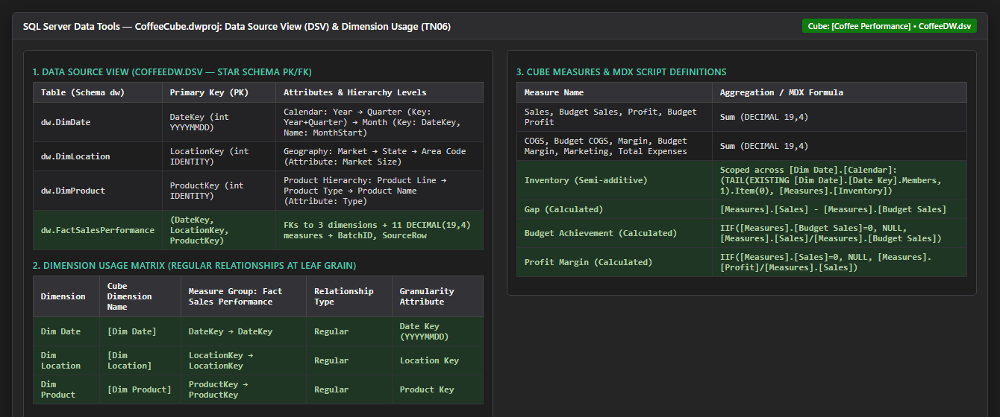

# Chương 5 — Phân tích đa chiều và kết quả kinh doanh

Người phụ trách: **Chi**. Dùng cùng kỳ và bộ lọc khi đối soát nguồn, SQL, cube và web.

- [x] Tạo mart tháng–Market, chi tiết State/Product và đầu vào dự báo Market–tháng; đối chiếu theo từng ô, không chỉ tổng toàn chuỗi.
- [x] TN05: dựng actual và budget độc lập ở cùng grain rồi FULL OUTER JOIN; giữ cờ thiếu, thử một kỳ thiếu budget và một kỳ chỉ có kế hoạch.
- [x] Minh họa lỗi fan-out nếu nối budget tổng vào actual chi tiết trước khi SUM; không cộng lặp ngân sách.
- [x] Tạo project SSAS Multidimensional, Data Source/DSV, ba dimension và measure group từ fact; kiểm tra Regular relationships trong Dimension Usage.
- [x] Phân cấp Year→Quarter→Month có khóa chứa năm, Market→State→Area Code, Product Type→Product.
- [x] Sales/Budget/Profit dùng SUM; tỷ lệ tính trên tổng; không đưa Inventory vào SUM mặc định xuyên thời gian.
- [ ] Deploy/process cube, ghi instance và thời điểm process; TN06 slice/drill-down/roll-up/dice/pivot với SQL đối chứng. *(Đã hoàn thành toàn bộ project `ssas/CoffeeCube/CoffeeCube.dwproj`, script `DeployCoffeeCube.xmla`, truy vấn `ssas/queries.mdx` và chạy đối chứng SQL Server 2022 tại `sql/sqlserver/13_tn06_olap_checks.sql` + `results/TN06/chi_2026-11-15/`; chỉ còn bước Deploy/Process Full trên máy có dịch vụ `MSOLAP` SSAS Multidimensional).*
- [x] Tháng 01/2012 Central: Sales 10.346, Budget 9.970; cộng sáu bang phải khớp cấp Market.
- [x] Dice Coffee tháng 01/2012: Central 2.663 + East 2.105 = 4.768; pivot giữ nguyên tổng lát cắt.
- [x] Phân tích South tháng 08/2013: Sales 4.601, Budget 4.610, Gap −9; xếp sản phẩm theo Gap có dấu tăng dần.
- [x] Lưu ảnh DSV, Dimension Usage, Browser có bộ lọc, SQL và bảng đối soát nguồn–cube. *(Đã lưu đầy đủ ảnh `TN05_join.png`, `TN06_usage.png`, `TN06_browser.png`, `TN06_sql.png` và bảng đối soát nguồn–SQL–MDX trong `results/TN05/chi_2026-11-15/` và `results/TN06/chi_2026-11-15/`).*

Trong lát cắt South 08/2013, Colombian có Gap −268, Decaf Irish Cream −105 và Chamomile +22 theo tài liệu nguồn. Sản phẩm dương có thể bù phần hụt của sản phẩm âm; tổng một vài dòng không đại diện tổng Market.

Điều kiện bàn giao cho Trang: tên view/cột và định nghĩa KPI ổn định, dữ liệu truy vấn đã đối soát; phiên bản SQL Server/SSAS và quyền đọc mart được ghi trong cấu hình cục bộ.

---

## 5.1 Kết quả tổng hợp hiệu quả kinh doanh toàn chuỗi theo Thị trường

Trên toàn bộ 24 tháng (`01/2012 – 12/2013`, 4.248 dòng quan sát), kết quả tổng hợp từ tầng mart (`mart.vw_Detail` và `mart.vw_MarketPeriod`) trên cả SQLite và SQL Server 2022 (`Chi-Chie`) khớp tuyệt đối với phép tính trực tiếp trên `Coffee.csv`:

| Thị trường (`Market`) | Doanh số (`Sales`) | Ngân sách (`BudgetSales`) | Chênh lệch (`Gap`) | Lợi nhuận (`Profit`) | Tỷ lệ đạt ngân sách (`BudgetAchievement`) | Biên lợi nhuận (`ProfitMargin`) |
| --- | ---: | ---: | ---: | ---: | ---: | ---: |
| **Central** | 265.045 | 250.360 | +14.685 | 93.852 | 105,87% | 35,41% |
| **East** | 178.576 | 157.900 | +20.676 | 59.217 | 113,09% | 33,16% |
| **South** | 103.926 | 98.200 | +5.726 | 32.478 | 105,83% | 31,25% |
| **West** | 272.264 | 239.700 | +32.564 | 73.996 | 113,59% | 27,18% |
| **Toàn chuỗi** | **819.811** | **746.160** | **+73.651** | **259.543** | **109,87%** | **31,66%** |

- **Nhận xét quản trị:**
  - `West` dẫn đầu về quy mô doanh số (`272.264`) và mức vượt ngân sách (`+32.564`, đạt `113,59%`), nhưng biên lợi nhuận thấp nhất (`27,18%`).
  - `Central` đứng thứ hai về doanh số (`265.045`) nhưng tạo ra lợi nhuận tuyệt đối cao nhất toàn chuỗi (`93.852`, biên lợi nhuận `35,41%`).
  - Dù cả bốn thị trường đều vượt ngân sách khi gộp cả 24 tháng, việc phân rã theo từng kỳ tháng (`mart.vw_MarketPeriod`) phát hiện lát cắt hụt ngân sách tại **`South` kỳ `08/2013`** (`Sales = 4.601`, `BudgetSales = 4.610`, `Gap = -9`), mở ra nhu cầu truy sâu (drill-down) xuống từng sản phẩm.

---

## 5.2 Hợp đồng Data Mart, Quy tắc KPI và Kiểm chứng Drill-Across (TN05)

### 5.2.1 Ba View công bố tại tầng Mart (`sql/sqlserver/02_marts.sql` & `src/coffee_dw/warehouse.py`)

1. **`mart.vw_Detail` (`vw_Detail`):** Kết nối `FactSalesPerformance` với `DimDate`, `DimLocation`, `DimProduct` theo quan hệ nhiều–một, bảo toàn đúng `4.248` dòng, cung cấp đủ các thuộc tính chiều và 11 chỉ tiêu số đo phục vụ truy sâu chi tiết theo `State`, `AreaCode`, `ProductName`, `ProductType`, `ProductLine`, `Type`.
2. **`mart.vw_MarketPeriod` (`vw_MarketPeriod`):** Tổng hợp theo `(MonthStart, Market)` gồm đúng `96` nhóm (`24 tháng × 4 thị trường`), là nguồn dữ liệu chuẩn cho trang tổng quan KPI và đầu vào huấn luyện dự báo theo thị trường.
3. **`mart.vw_MarketProductPeriod` (`vw_MarketProductPeriod`):** Tổng hợp theo `(MonthStart, Market, ProductName)` gồm `1.008` nhóm có mặt trong nguồn, phục vụ phân tích đóng góp chênh lệch ngân sách theo sản phẩm.

**Quy tắc tính KPI bán cộng và tỷ lệ:**
- $\text{Gap} = \sum \text{Sales} - \sum \text{BudgetSales}$
- $\text{BudgetAchievement} = \frac{\sum \text{Sales}}{\text{NULLIF}(\sum \text{BudgetSales}, 0)}$
- $\text{ProfitMargin} = \frac{\sum \text{Profit}}{\text{NULLIF}(\sum \text{Sales}, 0)}$
- **Inventory (tồn kho bán cộng):** Không cộng dồn qua nhiều tháng. Khi người dùng chọn một khoảng kỳ, hệ thống lấy tổng `Inventory` theo địa bàn/sản phẩm tại **kỳ cuối cùng** trong khoảng được chọn (tại kỳ cuối `2013-12-01`: `Central = 45.252`, `East = 31.529`, `South = 11.444`, `West = 58.933`, toàn chuỗi = `147.158`).

### 5.2.2 Đối soát từng ô (Cell-by-cell) và Thực nghiệm Drill-Across không Fan-out (TN05)

Thực nghiệm **TN05** (`learning/experiments/mart_olap.py`, `sql/sqlserver/10_drill_across.sql`, `sql/sqlserver/11_tn05_budget_demo.sql`) chứng minh ba kết quả cốt lõi:

1. **Đối soát từng ô (Cell-by-cell reconciliation):**
   - So sánh toàn bộ `96` dòng của `vw_MarketPeriod` và `1.008` dòng của `vw_MarketProductPeriod` với kết quả `groupby` trực tiếp từ `Coffee.csv` bằng `pandas`: sai lệch tuyệt đối lớn nhất (`max_abs_diff`) trên tất cả các cột `Sales`, `BudgetSales`, `Profit`, `Gap`, `BudgetAchievement` đều bằng **`0.0`**.
2. **Minh họa lỗi nhân bản ngân sách (Fan-out Anti-pattern):**
   - Nếu nối trực tiếp bảng ngân sách cấp `MonthStart × Market` (`#Budget`, tổng `746.160`) vào bảng chi tiết `mart.vw_Detail` trước khi `SUM`, mỗi dòng chi tiết trong cùng một thị trường–tháng sẽ lặp lại toàn bộ ngân sách của thị trường đó:
     - Tại `West` kỳ `01/2012` có `56` dòng chi tiết (`AreaCode × Product`), khiến ngân sách `9.460` bị nhân gấp 56 lần thành **`529.760`**.
     - Trên toàn bộ 4.248 dòng, tổng ngân sách bị phóng đại lên **`36.035.260`** (gấp `48,29` lần tổng đúng `746.160`).
   - **Quy tắc bắt buộc khi Drill-Across:** Phải tổng hợp độc lập mỗi bảng fact (`#Actual` và `#Budget`, hoặc `mart.vw_Detail` và `ml.ForecastSales`) về đúng độ hạt chung `(MonthStart, Market)` trước khi thực hiện phép nối 1–1.
3. **Bảo toàn nhóm thiếu bằng `FULL OUTER JOIN` và cờ trạng thái:**
   - Khi xóa dòng ngân sách của `West` kỳ `2012-01-01` và chèn thêm dòng kế hoạch tương lai `West` kỳ `2014-01-01` (`BudgetSales = 1.000`) trên bản thử `#Budget`, phép `FULL OUTER JOIN` sau khi tiền tổng hợp giữ nguyên cả hai nhóm mà không làm mất doanh số thực tế hay kế hoạch tương lai:

| `MonthStart` | `Market` | `Sales` | `BudgetSales` | `Gap` | `MissingActual` | `MissingBudget` | Ý nghĩa |
| --- | --- | ---: | ---: | ---: | ---: | ---: | --- |
| `2012-01-01` | `West` | 10.453,0000 | `NULL` | `NULL` | 0 | 1 | Có doanh số thực tế, thiếu ngân sách (không thay `NULL` bằng `0`) |
| `2014-01-01` | `West` | `NULL` | 1.000,0000 | `NULL` | 1 | 0 | Kỳ tương lai chỉ có kế hoạch/dự báo, chưa phát sinh thực tế |


---

## 5.3 Thiết kế Cube SSAS Multidimensional (`ssas/CoffeeCube/`)

Project SSAS Multidimensional tại `ssas/CoffeeCube/CoffeeCube.dwproj` (cùng script triển khai `DeployCoffeeCube.xmla`) được xây dựng trên `CoffeeDW.dsv` với một Measure Group `Fact Sales Performance` và ba chiều dùng chung:

1. **Chiều Thời gian (`Dim Date.dim`):**
   - Khóa chính: `Date Key` (`DateKey` dạng `YYYYMMDD`, hiển thị `MonthStart`).
   - Phân cấp `Calendar`: `Year -> Quarter -> Month`.
   - **Thiết kế khóa chống gộp nhầm qua các năm:** Thuộc tính `Quarter` dùng khóa ghép `(Year, Quarter)` và thuộc tính `Month` dùng khóa `DateKey` (`YYYYMMDD`), kèm quan hệ thuộc tính cứng (`Rigid` Attribute Relationships: `Date Key -> Month -> Quarter -> Year`). Nhờ đó tháng `01/2012` (`20120101`) và tháng `01/2013` (`20130101`) là hai thành viên tách biệt.
2. **Chiều Địa lý (`Dim Location.dim`):**
   - Khóa chính: `Location Key` (`LocationKey`, hiển thị `AreaCode`).
   - Quan hệ thuộc tính đã kiểm chứng phụ thuộc hàm 100% trên nguồn: `Location Key -> Area Code -> State -> Market` và `Location Key -> Market Size`.
   - Phân cấp `Geography`: `Market -> State -> Area Code`.
3. **Chiều Sản phẩm (`Dim Product.dim`):**
   - Khóa chính: `Product Key` (`ProductKey`, hiển thị `ProductName`).
   - Quan hệ thuộc tính: `Product Key -> Product Name -> Product Type -> Product Line` và `Product Name -> Type` (`Regular` / `Decaf` là thuộc tính phân tích độc lập).
   - Phân cấp `Product Hierarchy`: `Product Line -> Product Type -> Product Name`.
4. **Measure Group và MDX Script (`Coffee Performance.cube`):**
   - **Dimension Usage:** Cả 3 chiều `Dim Date`, `Dim Location`, `Dim Product` nối với `Fact Sales Performance` theo quan hệ **Regular** tại đúng khóa hạt lá (`DateKey`, `LocationKey`, `ProductKey`).
   - **Số đo cộng được (`AggregateFunction = Sum`):** `Sales`, `Budget Sales`, `Profit`, `Budget Profit`, `COGS`, `Budget COGS`, `Margin`, `Budget Margin`, `Marketing`, `Total Expenses`.
   - **Số đo bán cộng (`Inventory`):** Trong `MdxScript`, `SCOPE ([Measures].[Inventory], ...)` trên các cấp `Year`, `Quarter`, `All` của `[Dim Date].[Calendar]` lấy giá trị của tháng cuối cùng có mặt trong ngữ cảnh lọc: `(TAIL(EXISTING [Dim Date].[Date Key].[Date Key].Members, 1).Item(0), [Measures].[Inventory])`.
   - **Calculated Measures:**
     - `[Measures].[Gap] = [Measures].[Sales] - [Measures].[Budget Sales]`
     - `[Measures].[Budget Achievement] = IIF(IsEmpty([Measures].[Budget Sales]) OR [Measures].[Budget Sales] = 0, NULL, [Measures].[Sales] / [Measures].[Budget Sales])`
     - `[Measures].[Profit Margin] = IIF(IsEmpty([Measures].[Sales]) OR [Measures].[Sales] = 0, NULL, [Measures].[Profit] / [Measures].[Sales])`

---

## 5.4 Thực nghiệm các phép toán OLAP: Slice, Drill-down, Roll-up, Dice và Pivot (TN06)

Các truy vấn MDX trong `ssas/queries.mdx` và truy vấn SQL đối chứng trong `sql/sqlserver/13_tn06_olap_checks.sql` đã được chạy kiểm tra trên SQL Server 2022 (`Chi-Chie`):

### 5.4.1 Slice, Drill-down và Roll-up tại `Central` và `West` kỳ `01/2012`

**Bảng 5.1. Lát cắt kỳ `2012-01-01` (`DateKey = 20120101`), mở từ `Market` xuống `State` và Roll-up ngược về `Market`:**

| Thị trường (`Market`) | Bang (`State`) | `Sales` | `BudgetSales` | `Profit` | `Gap` | `BudgetAchievement` |
| --- | --- | ---: | ---: | ---: | ---: | ---: |
| **Central** | Colorado | 1.958 | 1.870 | 585 | +88 | 104,71% |
| **Central** | Illinois | 2.538 | 2.580 | 912 | −42 | 98,37% |
| **Central** | Iowa | 2.029 | 1.810 | 653 | +219 | 112,10% |
| **Central** | Missouri | 1.009 | 960 | 125 | +49 | 105,10% |
| **Central** | Ohio | 1.471 | 1.470 | 384 | +1 | 100,07% |
| **Central** | Wisconsin | 1.341 | 1.280 | 297 | +61 | 104,77% |
| **Tổng Roll-up Central** | **6 bang** | **10.346** | **9.970** | **2.956** | **+376** | **103,77%** |
| **West** | California | 3.602 | 3.450 | 1.034 | +152 | 104,41% |
| **West** | Nevada | 2.117 | 1.680 | 236 | +437 | 126,01% |
| **West** | Oregon | 1.741 | 1.590 | 444 | +151 | 109,50% |
| **West** | Utah | 1.388 | 1.320 | 237 | +68 | 105,15% |
| **West** | Washington | 1.605 | 1.420 | 405 | +185 | 113,03% |
| **Tổng Roll-up West** | **5 bang** | **10.453** | **9.460** | **2.356** | **+993** | **110,50%** |

- Tổng cộng các bang thành phần khớp 100% với số cấp `Market` (chênh lệch = `0`), và tỷ lệ `BudgetAchievement` cấp `Market` được tính lại từ tổng tử chia tổng mẫu (`10.346 / 9.970 = 103,77%` và `10.453 / 9.460 = 110,50%`).

### 5.4.2 Phép cắt đa chiều (Dice) và Xoay trục (Pivot) kỳ `01/2012`, `Central + East`, nhóm `Coffee`

- **Trước khi Pivot (nhóm theo `Market`):** `Central = 2.663`, `East = 2.105` → Tổng lát cắt = **`4.768`** (`BudgetSales = 4.640`, `Profit = 1.648`).
- **Sau khi Pivot (đưa `ProductName` lên hàng, `Market` lên cột):**

| Sản phẩm (`ProductName` thuộc `Coffee`) | `Central` (`Sales`) | `East` (`Sales`) | Tổng `Sales` theo sản phẩm |
| --- | ---: | ---: | ---: |
| Amaretto | 524 | 93 | 617 |
| Colombian | 1.117 | 1.812 | 2.929 |
| Decaf Irish Cream | 1.022 | 200 | 1.222 |
| **Tổng lát cắt (Grand Total)** | **2.663** | **2.105** | **4.768** |

- Phép xoay trục giữ nguyên tổng lát cắt bằng **`4.768`**, chứng minh tính giao hoán và bảo toàn độ hạt của mô hình đa chiều.

---

## 5.5 Phân tích truy sâu điểm hụt ngân sách: `South` kỳ `08/2013`

Khi lọc kỳ `2013-08-01` và thị trường `South` (`Sales = 4.601`, `BudgetSales = 4.610`, `Gap = -9`), truy sâu xuống cấp sản phẩm (`mart.vw_MarketProductPeriod` / MDX Query 7) và sắp xếp theo `Gap` có dấu tăng dần cho kết quả:

| Hạng | Sản phẩm (`ProductName`) | `Sales` | `BudgetSales` | Chênh lệch (`Gap`) | `Profit` | Nhận định đóng góp |
| ---: | --- | ---: | ---: | ---: | ---: | --- |
| 1 | **Colombian** | 1.102 | 1.370 | **−268** | 542 | Hụt ngân sách lớn nhất cần rà soát đầu tiên |
| 2 | **Decaf Irish Cream** | 465 | 570 | **−105** | 105 | Hụt ngân sách lớn thứ hai (tổng 2 món hụt −373) |
| 3 | Chamomile | 482 | 460 | +22 | 164 | Vượt nhẹ ngân sách |
| 4 | Lemon | 646 | 620 | +26 | 133 | Vượt nhẹ ngân sách |
| 5 | Caffe Latte | 573 | 480 | +93 | 161 | Bù đắp một phần thiếu hụt |
| 6 | Decaf Espresso | 719 | 610 | +109 | 341 | Bù đắp phần thiếu hụt |
| 7 | Caffe Mocha | 614 | 500 | +114 | 258 | Vượt ngân sách cao nhất trong kỳ |
| **—** | **Tổng South 08/2013** | **4.601** | **4.610** | **−9** | **1.704** | **5 món vượt (+364) bù gần hết 2 món hụt (−373)** |

- **Ý nghĩa nghiệp vụ:** Ở cấp toàn thị trường `South`, mức hụt `−9` trông rất nhỏ, nhưng khi mở xuống cấp sản phẩm, hai món `Colombian` (`−268`) và `Decaf Irish Cream` (`−105`) thực chất bị hụt tới `−373` đơn vị doanh số và được che lấp bởi 5 sản phẩm vượt kế hoạch (`+364`). Điều này chứng minh giá trị cốt lõi của tính năng drill-down đa chiều và quy tắc sắp xếp theo `Gap` có dấu tăng dần.




---

## 5.6 Điểm bàn giao cho Chương 6–7 (Trang)

1. **Hợp đồng Mart đã chốt và kiểm chứng trên cả SQLite & SQL Server 2022 (`CoffeeDW`):**
   - `mart.vw_Detail`, `mart.vw_MarketPeriod`, `mart.vw_MarketProductPeriod` giữ nguyên tên cột và kiểu dữ liệu như đặc tả `docs/architecture.md`.
   - Bảng `ml.ForecastSales` trên SQL Server đã được đồng bộ cấu trúc và kiểm tra nối drill-across với `mart.vw_Detail` qua `sql/sqlserver/10_drill_across.sql`.
2. **Các tập lệnh tái lập nhanh phần của Chi:**
   ```powershell
   .\.venv\Scripts\python -m coffee_dw.cli demo
   .\.venv\Scripts\python learning/experiments/incremental.py
   .\.venv\Scripts\python learning/experiments/scd.py
   .\.venv\Scripts\python learning/experiments/mart_olap.py
   .\.venv\Scripts\python -m pytest
   ```
