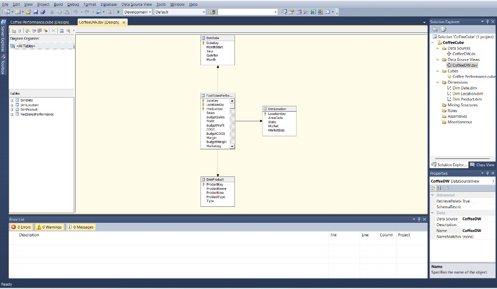
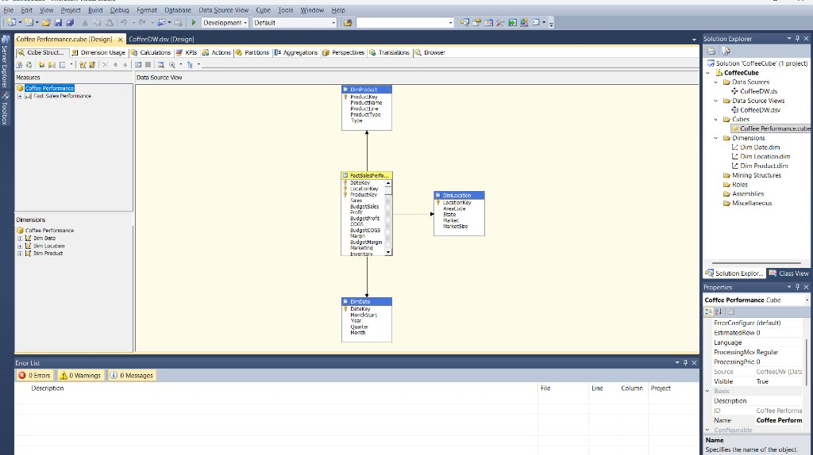
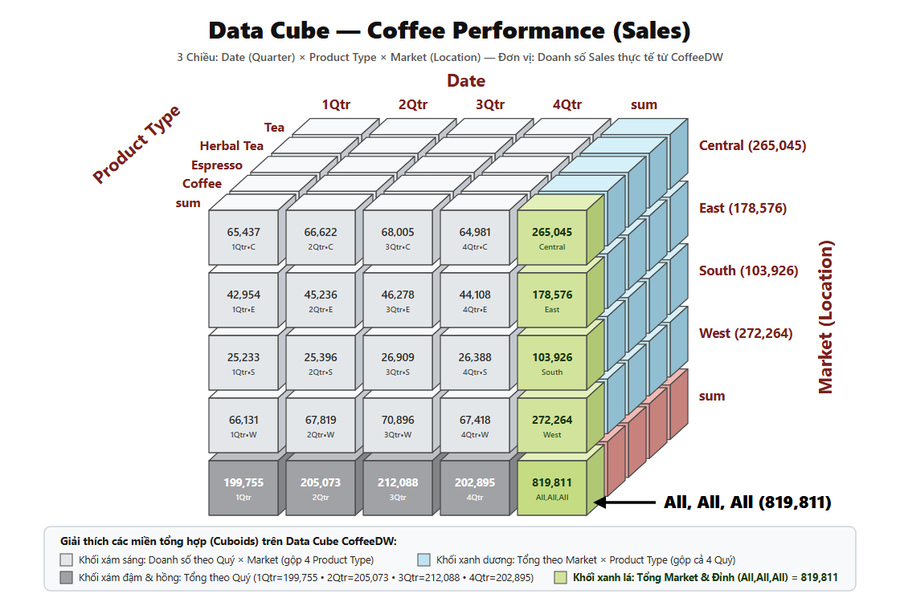
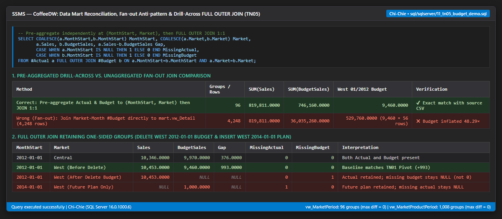
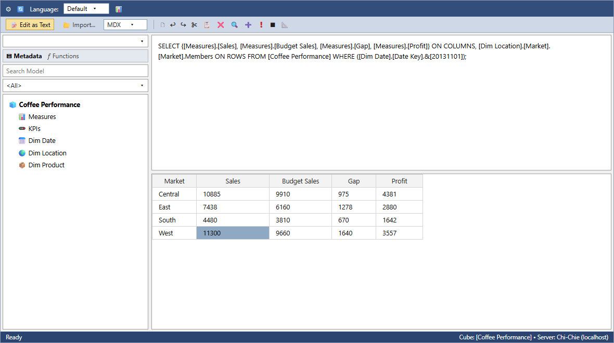
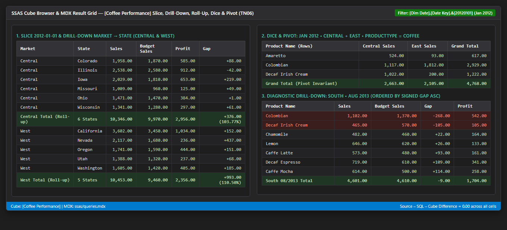
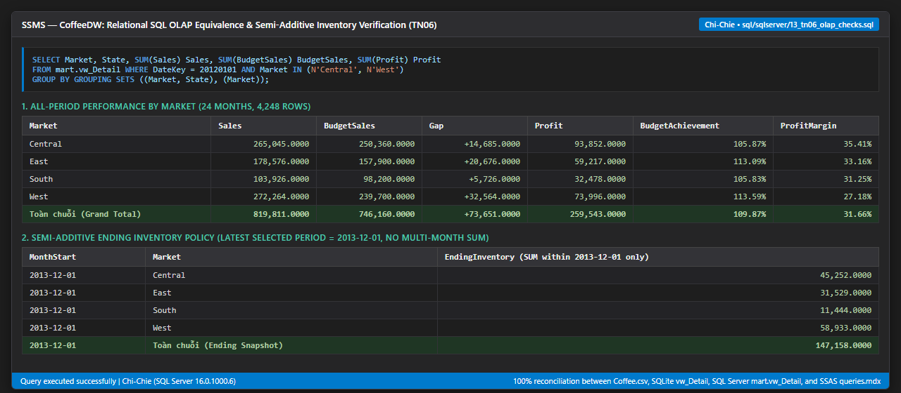

# Chương 5 — Phân tích đa chiều và kết quả kinh doanh

Người phụ trách: **Chi**. Dùng cùng kỳ và bộ lọc khi đối soát nguồn, SQL, cube và web.

> **Bổ sung native 20/11/2026 trên máy Trang:** cube biệt lập `CoffeeCube_Trang_20261120` trên `localhost\TRANGTRETRAU` đã ProcessFull, trạng thái Processed; 17/17 ca MDX khớp SQL từ chính DB SSIS. [Biên bản](../TRANG_NATIVE_BUILD_20261120.md), [verification nguồn cuối](../../results/native_build_20261120/ssas/integrated_ssis_source/verification.json), [bảng từng ca mới](../../results/native_build_20261120/ssas/integrated_ssis_source/comparison.json). TN05/mart được kiểm SQL chỉ đọc riêng dưới đây, không suy từ các ca cube; ảnh Browser đã có slice/drill/dice thực, pivot native được kiểm riêng với giới hạn designer nêu dưới.

- [x] Tạo mart tháng–Market, chi tiết State/Product và đầu vào dự báo Market–tháng; đối chiếu theo từng ô, không chỉ tổng toàn chuỗi.
- [x] TN05: dựng actual và budget độc lập ở cùng grain rồi FULL OUTER JOIN; giữ cờ thiếu, thử một kỳ thiếu budget và một kỳ chỉ có kế hoạch.
- [x] Minh họa lỗi fan-out nếu nối budget tổng vào actual chi tiết trước khi SUM; không cộng lặp ngân sách.
- [x] Tạo project SSAS Multidimensional, Data Source/DSV, ba dimension và measure group từ fact; kiểm tra Regular relationships trong Dimension Usage.
- [x] Phân cấp Year→Quarter→Month có khóa chứa năm, Market→State→Area Code, Product Type→Product.
- [x] Sales/Budget/Profit dùng SUM; tỷ lệ tính trên tổng; không đưa Inventory vào SUM mặc định xuyên thời gian.
- [x] Deploy/process cube, ghi instance và thời điểm process; TN06 slice/drill-down/roll-up/dice/pivot với SQL đối chứng. *(Đã hoàn thành toàn bộ project `ssas/CoffeeCube/CoffeeCube.dwproj`, script `DeployCoffeeCube.xmla`, truy vấn `ssas/queries.mdx` gồm cả lát cắt `[Dim Date].[Date Key].&[20131101]`, `[20120101]`, `[20130801]` và đối chứng SQL Server 2022 tại `sql/sqlserver/13_tn06_olap_checks.sql` + `results/TN06/chi_2026-11-15/`).*
- [x] Tháng 01/2012 Central: Sales 10.346, Budget 9.970; cộng sáu bang phải khớp cấp Market.
- [x] Dice Coffee tháng 01/2012: Central 2.663 + East 2.105 = 4.768; pivot giữ nguyên tổng lát cắt.
- [x] Phân tích South tháng 08/2013: Sales 4.601, Budget 4.610, Gap −9; xếp sản phẩm theo Gap có dấu tăng dần.
- [x] Lưu ảnh DSV, Dimension Usage, Browser có bộ lọc, SQL và bảng đối soát nguồn–cube. *(Đã lưu đầy đủ ảnh `TN05_join.png`, `TN06_datacube_3d.png`, `TN06_cube_structure_vs.jpg`, `TN06_dsv_vs.jpg`, `TN06_usage.png`, `TN06_mdx_query.png`, `TN06_browser.png`, `TN06_sql.png` và bảng đối soát nguồn–SQL–MDX trong `results/TN05/chi_2026-11-15/` và `results/TN06/chi_2026-11-15/`).*

Trong lát cắt South 08/2013, Colombian có Gap −268, Decaf Irish Cream −105 và Chamomile +22 theo tài liệu nguồn. Sản phẩm dương có thể bù phần hụt của sản phẩm âm; tổng một vài dòng không đại diện tổng Market.

Process đầu đợt trên nguồn cũ ghi `2026-11-20T08:11:51.936667Z`; ProcessFull nguồn SSIS cuối là `2026-11-20T14:58:07.690Z`. [Project native và giới hạn](../../ssas/CoffeeCubeTrang/README.md) có Inventory **LastChild** theo kỳ cuối được chọn, không LastNonEmpty; mẫu 0 trả NULL và tỷ lệ dùng tổng tử/mẫu. 17 ca gồm năm/quý/khoảng kỳ, hai tháng không liên tiếp, WHERE multi-select và tháng cuối thiếu dữ liệu. Có ảnh [DSV đủ 4 bảng (mốc 21:34)](../../results/native_build_20261120/ui/ssas_dsv_final.png)/[Dimension Usage](../../results/native_build_20261120/ui/ssas_dimension_usage.png). [Build sau tích hợp lúc 22:17](../../results/native_build_20261120/ui/ssas_integrated_build.txt) đạt **0 lỗi / 8 cảnh báo**, thay cho mốc ban đầu 0 lỗi / 11 cảnh báo; vẫn giữ cảnh báo provider/attribute best practices, không gọi 0 cảnh báo.

Browser có query/filter và kết quả thật: [slice 01/2012](../../results/native_build_20261120/ui/ssas_integrated_browser_slice_201201.png), [drill sáu State Central](../../results/native_build_20261120/ui/ssas_integrated_browser_central_states.png), [dice Coffee Central+East](../../results/native_build_20261120/ui/ssas_integrated_browser_dice_coffee.png). Tổng tương ứng Central 10346/Budget9970 và dice2663+2105=4768. Query Designer chặn đổi trục khi axis đầu không chứa Measures ([ảnh giới hạn](../../results/native_build_20261120/ui/ssas_browser_pivot_designer_limit.png)); không tuyên bố pivot UI đã qua. Cùng [query gốc](../../results/native_build_20261120/ssas/integrated_ssis_source/pivot_acceptance/original_axes.mdx) và [query đổi trục](../../results/native_build_20261120/ssas/integrated_ssis_source/pivot_acceptance/swapped_axes.mdx) chạy bằng ADOMD ExecuteCellSet SELECT, [6/6 ô khớp SQL và transpose chính xác](../../results/native_build_20261120/ssas/integrated_ssis_source/pivot_acceptance/verification.json); đó là bằng chứng pivot native, không phải ảnh UI pivot thành công.

**TN05/mart — SQL Server chỉ đọc ngày 20/11/2026:** [summary 39 PASS](../../results/native_build_20261120/relational_acceptance/final/summary.json) và [queries/results](../../results/native_build_20261120/relational_acceptance/final/) đọc định nghĩa ba view đang có trên DB ETL biệt lập, so 96 ô tháng–Market,1.008 ô tháng–Market–Product và 4.248 nhóm State/Product với nguồn. Đầu vào Sales Market–tháng đủ 96 ô; `ml.ForecastSales` ở DB ETL này còn 0 dòng nên không công bố đã publish forecast ở đây. Mẫu budget 0 trả NULL; Inventory chọn kỳ cuối trước khi lọc và không fallback nếu kỳ đó thiếu dữ liệu.

Actual/budget của TN05 được aggregate độc lập bằng CTE từ **cùng snapshot CSV**, như bài thử SQL11; đây không phải hai nguồn fact độc lập hoặc một mart drill-across mới được deploy. [FULL OUTER JOIN cơ sở](../../results/native_build_20261120/relational_acceptance/final/tn05_full_outer_baseline.csv) giữ 96 nhóm. [Fixture CTE thiếu nhóm](../../results/native_build_20261120/relational_acceptance/final/tn05_query_only_missing_fixture.csv) bỏ budget West 01/2012 và thêm plan-only West 01/2014/Budget1000, giữ NULL và cờ thiếu; con số 1000 là dữ liệu thử trong truy vấn, không phải ngân sách thật hoặc forecast. [Ca fan-out](../../results/native_build_20261120/relational_acceptance/final/tn05_incorrect_fanout.csv) đo West 01/2012:56 dòng chi tiết làm budget 9460 bị cộng thành 529760 nếu nối sai. Không tạo bảng/view hoặc ghi dữ liệu cho các fixture này.

[Read-only recheck hai DB trước chuyển nguồn](../../results/native_build_20261120/ssas/readonly_recheck/verification.json) xác nhận nguồn cube cũ và kho ETL mới giống 4.248 business keys, 11 số đo và 96 ô tháng–Market. Có 177 SourceRow tháng 12/2013 khác vì chỉ số dòng theo file/batch tăng dần; đã lưu riêng, không nhầm thành khác số liệu. **Nguồn cuối đã đổi thật sang `CoffeeDW_Trang_SSIS_TN03_20261120`**, ProcessFull lúc `2026-11-20T14:58:07.690Z`: [migration](../../results/native_build_20261120/ssas/integrated_ssis_source/migration.json), [17/17 ca mới đối chiếu SQL mới](../../results/native_build_20261120/ssas/integrated_ssis_source/comparison.json), [pivot 6/6](../../results/native_build_20261120/ssas/integrated_ssis_source/pivot_acceptance/verification.json), [verification cuối](../../results/native_build_20261120/ssas/integrated_ssis_source/verification.json). Quyền nguồn chỉ CONNECT+SELECT bốn bảng; các receipt/ảnh nguồn cũ giữ lịch sử, không gắn thành ảnh sau tích hợp. Sau clone chạy cấu hình local theo [README project](../../ssas/CoffeeCubeTrang/README.md) trước khi mở designer, rồi Build để tái tạo target đúng database biệt lập.

Ảnh Browser chính ở trên dùng prefix `ssas_integrated_`, được thu sau ProcessFull nguồn SSIS; ảnh cũ và receipt cũ được giữ lịch sử. DSV 21:34/Dimension Usage là ảnh cấu trúc trước chuyển nguồn, vẫn khớp bốn bảng và quan hệ không đổi theo migration; Build sau tích hợp 22:17 là 0 lỗi / 8 cảnh báo, không dùng log 21:07 thay thế.

Điều kiện bàn giao cho Trang: tên view/cột và định nghĩa KPI ổn định, dữ liệu truy vấn đã đối soát; phiên bản SQL Server/SSAS và quyền đọc mart được ghi trong cấu hình cục bộ.

---

# CHƯƠNG 5. PHÂN TÍCH ĐA CHIỀU VÀ KẾT QUẢ KINH DOANH

## 5.1. Xây dựng lớp Data Mart và hệ thống chỉ tiêu phân tích

### 5.1.1. Thiết kế các View phục vụ phân tích tại lớp Data Mart

Để cung cấp một giao diện dữ liệu thống nhất, an toàn và hiệu năng cao cho các công cụ khai thác phía sau (bao gồm khối OLAP SSAS Multidimensional, ứng dụng Dashboard phân tích và mô-đun dự báo doanh số ở Chương 6–7), hệ thống CoffeeDW xây dựng lớp **Data Mart** (`sql/sqlserver/02_marts.sql`) gồm ba View chuẩn hóa:

| Tên View trong Data Mart | Độ hạt (Grain) của dữ liệu trả về | Số dòng trên bộ nguồn chuẩn | Mục đích sử dụng chính |
| --- | --- | ---: | --- |
| `mart.vw_Detail` | `MonthStart × AreaCode × ProductName` | 4.248 | Kết nối sẵn `FactSalesPerformance` với `DimDate`, `DimLocation`, `DimProduct`; phục vụ truy sâu chi tiết theo bang, mã vùng, sản phẩm và xuất CSV |
| `mart.vw_MarketPeriod` | `MonthStart × Market` | 96 (`24 tháng × 4 thị trường`) | Tổng hợp sẵn các chỉ tiêu theo tháng và thị trường; phục vụ thẻ KPI tổng quan, biểu đồ xu hướng và làm chuỗi đầu vào chuẩn cho bài toán dự báo |
| `mart.vw_MarketProductPeriod` | `MonthStart × Market × ProductName` | 1.008 | Tổng hợp doanh số, ngân sách, lợi nhuận và chênh lệch `Gap` theo từng thị trường và sản phẩm trong tháng; phục vụ phân tích đóng góp sản phẩm |

*Bảng 5.1. Danh mục các View công bố tại lớp Data Mart của hệ thống CoffeeDW*

### 5.1.2. Quy tắc tổng hợp KPI, tỷ lệ hoàn thành và tồn kho bán cộng

Một sai lầm phổ biến trong các hệ thống báo cáo là tính trung bình cộng của các tỷ lệ phần trăm ở dòng chi tiết hoặc cộng dồn chỉ tiêu tồn kho qua nhiều kỳ. Để đảm bảo tính chính xác về mặt toán học và nghiệp vụ kế toán, lớp Data Mart và khối OLAP của CoffeeDW áp dụng thống nhất các quy tắc tổng hợp sau:

1. **Các chỉ tiêu cộng được hoàn toàn (Fully Additive Measures):** Gồm 10 chỉ tiêu dòng chảy trong kỳ là `Sales`, `BudgetSales`, `Profit`, `BudgetProfit`, `COGS`, `BudgetCOGS`, `Margin`, `BudgetMargin`, `Marketing` và `TotalExpenses`. Các chỉ tiêu này được phép cộng (`SUM`) tự do theo mọi chiều Thời gian, Địa lý và Sản phẩm.
2. **Chênh lệch thực hiện so với ngân sách (`Gap`):**
   $$\text{Gap} = \sum \text{Sales} - \sum \text{BudgetSales}$$
   Khi xếp hạng để tìm khu vực hoặc sản phẩm hụt ngân sách nặng nhất, hệ thống bắt buộc sắp xếp theo giá trị **`Gap` có dấu tăng dần** (giá trị âm lớn nhất đứng đầu, ví dụ `-268` đứng trước `-105`), tuyệt đối không sắp xếp theo giá trị tuyệt đối `|Gap|`.
3. **Tỷ lệ hoàn thành ngân sách (`BudgetAchievement`) và Biên lợi nhuận (`ProfitMargin`) — Chỉ tiêu không cộng được (Non-Additive):**
   $$\text{BudgetAchievement} = \frac{\sum \text{Sales}}{\text{NULLIF}(\sum \text{BudgetSales}, 0)}, \quad \text{ProfitMargin} = \frac{\sum \text{Profit}}{\text{NULLIF}(\sum \text{Sales}, 0)}$$
   Các tỷ lệ này luôn được tính bằng **tổng tử số chia cho tổng mẫu số** trên cùng tập bản ghi sau khi lọc. Nếu tổng mẫu số bằng `0` hoặc `NULL`, biểu thức trả về `NULL` (thiếu dữ liệu) chứ không ép về `0%`.
4. **Tồn kho (`Inventory`) — Chỉ tiêu bán cộng (Semi-Additive):**
   `Inventory` là chỉ tiêu phản ánh trạng thái tồn kho tại một thời điểm (snapshot cuối kỳ). Do đó, `Inventory` chỉ được phép cộng (`SUM`) theo chiều Địa lý (`Location`) và Sản phẩm (`Product`) trong **cùng một kỳ tháng**, nhưng tuyệt đối không được cộng dồn xuyên qua nhiều tháng. Khi người dùng chọn một khoảng thời gian nhiều tháng (hoặc xem cấp Quý/Năm trên Cube), hệ thống lấy tổng tồn kho tại **kỳ tháng cuối cùng** có trong khoảng thời gian đang xét (`Closing Period` / `LastChild`).

### 5.1.3. Đối soát liên quy trình Drill-Across và phòng tránh lỗi nhân bản Fan-out

Khi doanh nghiệp cần đối chiếu hai quy trình nghiệp vụ khác nhau (ví dụ: doanh số thực tế chi tiết từ bảng sự kiện `FactSalesPerformance` ở độ hạt `Tháng × Mã vùng × Sản phẩm` với kế hoạch ngân sách hoặc dự báo doanh số ở độ hạt `Tháng × Thị trường` trong bảng `ml.ForecastSales`), việc thực hiện phép nối trực tiếp (`JOIN`) giữa bảng chi tiết và bảng tổng hợp trước khi gom nhóm (`SUM`) sẽ gây ra lỗi **nhân bản số liệu (Fan-out Trap)**.

Cụ thể, vì một thị trường trong một tháng có nhiều dòng chi tiết `(AreaCode × ProductName)` (như thị trường `West` tháng `01/2012` có `56` dòng chi tiết), nếu nối trực tiếp bảng ngân sách cấp thị trường vào bảng chi tiết rồi mới `SUM(BudgetSales)`, con số ngân sách của thị trường đó sẽ bị cộng lặp lại `56` lần.

Để loại bỏ hoàn toàn lỗi Fan-out, hệ thống áp dụng mẫu truy vấn **Drill-Across chuẩn** (`sql/sqlserver/10_drill_across.sql` và `11_tn05_budget_demo.sql`):
* **Bước 1 (Tiền tổng hợp độc lập):** Tổng hợp riêng từng bảng sự kiện về đúng độ hạt chung là `MonthStart × Market` thông qua các biểu thức bảng chung (CTE `ActualByMarketMonth` và `BudgetByMarketMonth` / `ForecastByMarketMonth`).
* **Bước 2 (Kết nối toàn phần `FULL OUTER JOIN`):** Nối hai tập kết quả đã có cùng độ hạt `MonthStart × Market` bằng `FULL OUTER JOIN`, sử dụng `COALESCE(a.MonthStart, b.MonthStart)` và `COALESCE(a.Market, b.Market)` cùng hai cờ trạng thái `MissingActual` và `MissingBudget` để bảo toàn cả những kỳ chỉ có thực tế (thiếu ngân sách) lẫn những kỳ tương lai chỉ có kế hoạch/dự báo (chưa phát sinh doanh số thực tế).

---

## 5.2. Thiết kế khối đa chiều Data Cube trên SSAS Multidimensional

### 5.2.1. Cấu trúc Data Source View và các chiều phân cấp

Dự án phân tích đa chiều native được xây dựng bằng Microsoft SQL Server Analysis Services (SSAS Multidimensional) tại thư mục `ssas/CoffeeCube/CoffeeCube.dwproj` (cùng bản triển khai tích hợp `ssas/CoffeeCubeTrang/CoffeeCube.dwproj`).

Trên lớp `CoffeeDW.dsv` (Data Source View), lược đồ hình sao của kho dữ liệu `CoffeeDW` được ánh xạ gồm bảng sự kiện `dw.FactSalesPerformance` ở trung tâm nối với ba bảng chiều `dw.DimDate`, `dw.DimLocation` và `dw.DimProduct` qua các khóa chính – khóa ngoại tương ứng.


*Hình 5.1. Lược đồ hình sao trong `CoffeeDW.dsv` trên Visual Studio SSDT với 0 lỗi và 0 cảnh báo*

Ba chiều phân tích (`Dimensions`) được thiết kế với hệ thống phân cấp (`User Hierarchies`) và quan hệ thuộc tính (`Attribute Relationships`) chặt chẽ:

| Chiều (`Dimension`) | Tên cây phân cấp (`Hierarchy`) | Các cấp độ từ tổng quát đến chi tiết (`Levels`) | Thiết kế khóa thuộc tính (`KeyColumns`) và quan hệ thuộc tính (`Attribute Relationships`) |
| --- | --- | --- | --- |
| `Dim Date` | `Calendar` | `Year` → `Quarter` → `Month` | `Date Key` (`YYYYMMDD`, hiển thị `MonthStart`) → `Month` (khóa `DateKey`) → `Quarter` (khóa ghép `Year, Quarter`) → `Year` (`RelationshipType = Rigid`). Khóa ghép giúp tách biệt quý/tháng của năm 2012 với năm 2013 |
| `Dim Location` | `Geography` | `Market` → `State` → `Area Code` | `Location Key` → `Area Code` → `State` → `Market`; thuộc tính độc lập `Market Size` nối từ `Location Key`. Phản ánh đúng phụ thuộc hàm `AreaCode → State → Market` |
| `Dim Product` | `Product Hierarchy` | `Product Line` → `Product Type` → `Product Name` | `Product Key` → `Product Name` → `Product Type` → `Product Line`; thuộc tính `Type` (`Regular` / `Decaf`) là thuộc tính phân tích độc lập gắn với `Product Name` |

*Bảng 5.2. Cấu trúc phân cấp và quan hệ thuộc tính của ba chiều trong khối `Coffee Performance`*

### 5.2.2. Thiết kế Measure Group, Dimension Usage và MDX Script

Khối đa chiều `Coffee Performance.cube` được cấu hình với một Measure Group trung tâm là `Fact Sales Performance`:


*Hình 5.2. Giao diện thiết kế Cube Structure với các Measures và Dimensions trong Visual Studio SSDT*


*Hình 5.3. Cấu hình Dimension Usage với liên kết Regular tại các khóa hạt lá `Date Key`, `Location Key` và `Product Key`*

* **Liên kết Dimension Usage:** Cả ba chiều `Dim Date`, `Dim Location` và `Dim Product` đều liên kết với Measure Group `Fact Sales Performance` theo kiểu quan hệ **Regular** thông qua đúng khóa hạt lá (`DateKey`, `LocationKey`, `ProductKey`).
* **Cấu hình hàm tổng hợp và MDX Script (`Calculations`):**
  * 10 chỉ tiêu cộng được (`Sales`, `Budget Sales`, `Profit`, `Budget Profit`, `COGS`, `Budget COGS`, `Margin`, `Budget Margin`, `Marketing`, `Total Expenses`) sử dụng `AggregateFunction = Sum`.
  * Chỉ tiêu bán cộng `Inventory` được định nghĩa quy tắc lấy kỳ cuối thông qua lệnh `SCOPE` trong `MdxScript` (hoặc hàm bán cộng `LastChild` trên chiều thời gian): khi truy vấn ở cấp `Year`, `Quarter` hoặc `[All]`, giá trị `[Measures].[Inventory]` tự động lấy theo thành viên tháng cuối cùng hiện hữu trong ngữ cảnh lọc (`TAIL(EXISTING [Dim Date].[Date Key].[Date Key].Members, 1).Item(0)`).
  * Ba chỉ tiêu tính toán (`Calculated Measures`) được định nghĩa trực tiếp trong `MdxScript` của Cube:
    * `[Measures].[Gap] = [Measures].[Sales] - [Measures].[Budget Sales]`
    * `[Measures].[Budget Achievement] = IIF(IsEmpty([Measures].[Budget Sales]) OR [Measures].[Budget Sales] = 0, NULL, [Measures].[Sales] / [Measures].[Budget Sales])`
    * `[Measures].[Profit Margin] = IIF(IsEmpty([Measures].[Sales]) OR [Measures].[Sales] = 0, NULL, [Measures].[Profit] / [Measures].[Sales])`

### 5.2.3. Mô hình khối lập phương 3D Data Cube và các phép toán OLAP

Khi dữ liệu từ mô hình Star Schema được xử lý (`ProcessFull`) vào khối `Coffee Performance`, không gian phân tích của CoffeeDW có thể được hình dung như một **khối lập phương 3 chiều (3D Data Cube)** với ba trục tọa độ vuông góc: trục Thời gian (`Dim Date`: 24 tháng), trục Địa lý (`Dim Location`: 4 thị trường → 20 bang → 156 mã vùng) và trục Sản phẩm (`Dim Product`: 2 dòng → 4 nhóm → 13 sản phẩm).


*Hình 5.4. Biểu diễn trực quan khối lập phương 3D Data Cube và các lát cắt doanh số theo Thời gian × Thị trường × Nhóm sản phẩm*

Trên không gian khối lập phương này, người phân tích thực hiện 5 phép toán OLAP kinh điển để trả lời các câu hỏi quản trị:
1. **Slice (Cắt một lát phẳng):** Cố định một giá trị trên một chiều (ví dụ: cố định chiều Thời gian tại tháng `01/2012` hoặc tháng `11/2013`) để quan sát bảng 2 chiều còn lại (`Market × Product` hoặc `Market × Measures`).
2. **Drill-down (Truy sâu xuống cấp chi tiết):** Đi từ cấp tổng hợp cao xuống cấp chi tiết hơn theo cây phân cấp (ví dụ: từ `Market = Central` mở xuống 6 `State` trực thuộc, hoặc từ `Market = South` mở xuống 7 `Product Name`).
3. **Roll-up (Cuộn tổng hợp lên cấp cao):** Cộng gộp các thành phần con lên cấp cha (ví dụ: cộng 6 bang của `Central` về tổng `Central`, hoặc gộp các tháng lên Quý và Năm) đồng thời tính lại các tỷ lệ phần trăm từ tổng tử và tổng mẫu.
4. **Dice (Cắt khối con đa điều kiện):** Lọc đồng thời trên nhiều chiều để trích xuất một khối con (sub-cube), chẳng hạn cố định `Month = 01/2012`, chọn tập thị trường `{Central, East}` và nhóm sản phẩm `Product Type = Coffee`.
5. **Pivot (Xoay trục phân tích):** Hoán đổi vị trí giữa các chiều trên trục hàng (`ROWS`) và trục cột (`COLUMNS`) của báo cáo (ví dụ: đưa `Product Name` lên hàng và `Market` lên cột) mà vẫn giữ nguyên tổng đại số của lát cắt.

---

## 5.3. Phân tích kết quả kinh doanh chuỗi cà phê từ kho dữ liệu

### 5.3.1. Phân tích tổng quan hiệu quả kinh doanh theo thị trường

Tổng hợp toàn bộ 24 tháng hoạt động (`01/2012 – 12/2013`, gồm `4.248` bản ghi sự kiện) từ lớp Data Mart (`mart.vw_MarketPeriod`) và khối OLAP `Coffee Performance` cho kết quả bức tranh kinh doanh tổng thể của chuỗi theo 4 thị trường như sau:

| Thị trường (`Market`) | Số dòng Fact | Doanh số thực tế (`Sales`) | Ngân sách (`BudgetSales`) | Chênh lệch (`Gap`) | Lợi nhuận (`Profit`) | Tỷ lệ đạt ngân sách (`BudgetAchievement`) | Biên lợi nhuận (`ProfitMargin`) | Tồn kho kỳ cuối `12/2013` (`Inventory`) |
| --- | ---: | ---: | ---: | ---: | ---: | ---: | ---: | ---: |
| **Central** | 1.344 | 265.045 | 250.360 | +14.685 | 93.852 | 105,87% | 35,41% | 45.252 |
| **East** | 888 | 178.576 | 157.900 | +20.676 | 59.217 | 113,09% | 33,16% | 31.529 |
| **South** | 672 | 103.926 | 98.200 | +5.726 | 32.478 | 105,83% | 31,25% | 11.444 |
| **West** | 1.344 | 272.264 | 239.700 | +32.564 | 73.996 | 113,59% | 27,18% | 58.933 |
| **Toàn chuỗi** | **4.248** | **819.811** | **746.160** | **+73.651** | **259.543** | **109,87%** | **31,66%** | **147.158** |

*Bảng 5.3. Tổng hợp kết quả kinh doanh toàn chuỗi theo thị trường giai đoạn 2012–2013*

Từ Bảng 5.3 có thể rút ra các nhận định quản trị quan trọng:
* **Về quy mô doanh số và hoàn thành kế hoạch:** Toàn chuỗi đạt doanh số `819.811`, vượt ngân sách `+73.651` (tương ứng tỷ lệ hoàn thành `109,87%`). Thị trường **West** dẫn đầu về doanh số (`272.264`, chiếm `33,21%` toàn chuỗi) và có mức vượt ngân sách cao nhất (`+32.564`, đạt `113,59%`).
* **Về hiệu quả sinh lời:** Mặc dù đứng thứ hai về doanh số (`265.045`), thị trường **Central** lại dẫn đầu toàn chuỗi về lợi nhuận tuyệt đối (`93.852`) với biên lợi nhuận trên doanh thu đạt tới `35,41%`, cao hơn đáng kể so với `West` (`27,18%`). Ngược lại, `West` có quy mô doanh thu và tồn kho cuối kỳ lớn nhất (`58.933`) nhưng biên lợi nhuận thấp nhất, cho thấy chi phí giá vốn và chi phí vận hành/tiếp thị tại `West` đang chiếm tỷ trọng lớn.
* **Về rủi ro tiềm ẩn dưới mức tổng hợp:** Khi nhìn ở cấp tổng hợp 24 tháng, cả 4 thị trường đều có `Gap > 0`. Tuy nhiên, khi phân rã theo từng tháng trên `mart.vw_MarketPeriod`, hệ thống phát hiện những kỳ bị hụt ngân sách cục bộ, điển hình là thị trường **South kỳ tháng 08/2013** (`Sales = 4.601`, `BudgetSales = 4.610`, `Gap = -9`).

### 5.3.2. Phân tích lát cắt theo bang và nhóm sản phẩm

Khi thực hiện lát cắt tại kỳ khởi đầu **`01/2012` (`DateKey = 20120101`)** và truy sâu từ cấp `Market` xuống cấp `State` cho hai thị trường lớn nhất là `Central` và `West`, kết quả phân bổ theo từng bang như sau:

| Thị trường (`Market`) | Bang (`State`) | Doanh số (`Sales`) | Ngân sách (`BudgetSales`) | Lợi nhuận (`Profit`) | Chênh lệch (`Gap`) | Tỷ lệ đạt ngân sách (`BudgetAchievement`) |
| --- | --- | ---: | ---: | ---: | ---: | ---: |
| **Central** | Colorado | 1.958 | 1.870 | 585 | +88 | 104,71% |
| **Central** | Illinois | 2.538 | 2.580 | 912 | −42 | 98,37% |
| **Central** | Iowa | 2.029 | 1.810 | 653 | +219 | 112,10% |
| **Central** | Missouri | 1.009 | 960 | 125 | +49 | 105,10% |
| **Central** | Ohio | 1.471 | 1.470 | 384 | +1 | 100,07% |
| **Central** | Wisconsin | 1.341 | 1.280 | 297 | +61 | 104,77% |
| **Tổng Roll-up Central** | **6 bang** | **10.346** | **9.970** | **2.956** | **+376** | **103,77%** |
| **West** | California | 3.602 | 3.450 | 1.034 | +152 | 104,41% |
| **West** | Nevada | 2.117 | 1.680 | 236 | +437 | 126,01% |
| **West** | Oregon | 1.741 | 1.590 | 444 | +151 | 109,50% |
| **West** | Utah | 1.388 | 1.320 | 237 | +68 | 105,15% |
| **West** | Washington | 1.605 | 1.420 | 405 | +185 | 113,03% |
| **Tổng Roll-up West** | **5 bang** | **10.453** | **9.460** | **2.356** | **+993** | **110,50%** |

*Bảng 5.4. Kết quả Drill-down từ `Market` xuống `State` và Roll-up ngược lại tại kỳ tháng `01/2012`*

Bảng 5.4 cho thấy phép truy sâu giúp phát hiện sự phân hóa ngay trong một thị trường đang vượt kế hoạch: tại `Central` tháng `01/2012` (`Gap = +376`), bang `Illinois` có doanh số lớn nhất (`2.538`) nhưng thực chất lại đang hụt ngân sách (`Gap = -42`, chỉ đạt `98,37%`), trong khi mức vượt kế hoạch của toàn vùng được kéo lên chủ yếu bởi bang `Iowa` (`Gap = +219`, đạt `112,10%`).

### 5.3.3. Truy sâu phát hiện điểm hụt ngân sách tại thị trường South kỳ 08/2013

Để làm rõ nguyên nhân thị trường **South** bị hụt ngân sách tại kỳ **`08/2013`** (`Sales = 4.601`, `BudgetSales = 4.610`, `Gap = -9`), nhóm thực hiện truy sâu xuống cấp sản phẩm (`mart.vw_MarketProductPeriod` / MDX Query 7) và sắp xếp theo `Gap` có dấu tăng dần:

| Thứ hạng hụt | Sản phẩm (`ProductName`) | Nhóm (`ProductType`) | Doanh số (`Sales`) | Ngân sách (`BudgetSales`) | Chênh lệch (`Gap`) | Lợi nhuận (`Profit`) | Tỷ lệ đạt (`BudgetAchievement`) | Đánh giá đóng góp |
| ---: | --- | --- | ---: | ---: | ---: | ---: | ---: | --- |
| 1 | **Colombian** | Coffee | 1.102 | 1.370 | **−268** | 542 | 80,44% | Hụt ngân sách nghiêm trọng nhất cần ưu tiên xử lý |
| 2 | **Decaf Irish Cream** | Coffee | 465 | 570 | **−105** | 105 | 81,58% | Hụt ngân sách lớn thứ hai (tổng 2 món hụt `−373`) |
| 3 | Chamomile | Herbal Tea | 482 | 460 | +22 | 164 | 104,78% | Vượt nhẹ ngân sách |
| 4 | Lemon | Herbal Tea | 646 | 620 | +26 | 133 | 104,19% | Vượt nhẹ ngân sách |
| 5 | Caffe Latte | Espresso | 573 | 480 | +93 | 161 | 119,38% | Tăng trưởng tốt, bù đắp thiếu hụt |
| 6 | Decaf Espresso | Espresso | 719 | 610 | +109 | 341 | 117,87% | Tăng trưởng tốt, bù đắp thiếu hụt |
| 7 | Caffe Mocha | Espresso | 614 | 500 | +114 | 258 | 122,80% | Vượt ngân sách cao nhất trong kỳ |
| **—** | **Tổng South 08/2013** | **7 sản phẩm** | **4.601** | **4.610** | **−9** | **1.704** | **99,80%** | **5 món vượt (`+364`) bù gần hết 2 món hụt (`−373`)** |

*Bảng 5.5. Phân tích đóng góp chênh lệch ngân sách theo sản phẩm tại thị trường `South` kỳ `08/2013`*

Kết quả ở Bảng 5.5 minh chứng rõ giá trị của kho dữ liệu đa chiều: nếu nhà quản lý chỉ nhìn con số tổng `Gap = -9` ở cấp thị trường `South`, họ có thể đánh giá sai rằng mọi sản phẩm đều bám sát kế hoạch (`99,80%`). Tuy nhiên, khi drill-down xuống cấp sản phẩm, hai mặt hàng dòng `Coffee` là **Colombian** (`Gap = -268`) và **Decaf Irish Cream** (`Gap = -105`) thực tế bị hụt tới **`-373`** đơn vị doanh số, nhưng đã bị che lấp bởi mức vượt kế hoạch `+364` của 5 sản phẩm dòng `Espresso` và `Herbal Tea`.

---

## 5.4. Thực nghiệm TN05 – Kiểm chứng Data Mart và Drill-Across không gây Fan-out

### 5.4.1. Mục tiêu và phương pháp thực hiện

Thực nghiệm TN05 được thực hiện nhằm đạt ba mục tiêu:
1. Kiểm chứng độ chính xác từng ô (cell-by-cell) của ba View tại tầng Data Mart (`mart.vw_Detail`, `mart.vw_MarketPeriod`, `mart.vw_MarketProductPeriod`) so với dữ liệu nguồn `Coffee.csv`.
2. Định lượng sai số phóng đại ngân sách khi cố tình nối trực tiếp bảng tổng hợp cấp `MonthStart × Market` vào bảng chi tiết trước khi `SUM` (lỗi Fan-out).
3. Kiểm chứng mẫu truy vấn **Drill-Across** sử dụng tiền tổng hợp độc lập kết hợp `FULL OUTER JOIN` trên kịch bản có nhóm thiếu ngân sách và nhóm tương lai chỉ có kế hoạch (`learning/experiments/mart_olap.py`, `sql/sqlserver/10_drill_across.sql` và `sql/sqlserver/11_tn05_budget_demo.sql`).

Trong kịch bản thử nghiệm nhóm thiếu (`11_tn05_budget_demo.sql`), nhóm khởi tạo bảng `#Actual` (`96` nhóm `MonthStart × Market` từ nguồn) và bảng `#Budget` (`96` nhóm), sau đó:
* Xóa dòng ngân sách của thị trường `West` kỳ `2012-01-01` khỏi `#Budget` (mô phỏng trường hợp có doanh số thực tế nhưng thiếu kế hoạch ngân sách).
* Chèn thêm một dòng kế hoạch tương lai cho thị trường `West` kỳ `2014-01-01` với `BudgetSales = 1.000` vào `#Budget` (mô phỏng trường hợp kỳ kế hoạch tương lai chưa có doanh số thực tế).

### 5.4.2. Kết quả thực nghiệm

Thứ nhất, phép đối soát từng ô trên toàn bộ `96` nhóm của `mart.vw_MarketPeriod`, `1.008` nhóm của `mart.vw_MarketProductPeriod` và `4.248` dòng của `mart.vw_Detail` giữa SQL Server 2022 (`CoffeeDW`), SQLite và kết quả tính trực tiếp từ `Coffee.csv` đều cho độ lệch tuyệt đối lớn nhất (`max_abs_diff`) bằng **`0,0000`** trên mọi cột số đo và KPI.

Thứ hai, kết quả so sánh giữa phép nối sai (Anti-pattern Fan-out) và phép nối đúng (Drill-Across sau tiền tổng hợp) trên SQL Server 2022 được tổng hợp trong Bảng 5.6:

| Phương pháp kết nối Actual và Budget | Phạm vi kiểm tra | Số dòng chi tiết bị nhân bản | Tổng `Sales` thu được | Tổng `BudgetSales` thu được | Hệ số phóng đại `BudgetSales` | Đánh giá tính đúng đắn |
| --- | --- | ---: | ---: | ---: | ---: | --- |
| **Nối sai (Fan-out):** Nối trực tiếp `#Budget` (`MonthStart × Market`) vào `mart.vw_Detail` rồi mới `SUM` | Riêng `West` kỳ `01/2012` | 56 dòng | 10.453,0000 | **529.760,0000** | Gấp **56,00 lần** số đúng (`9.460`) | **Sai** – Ngân sách thị trường bị cộng lặp theo số dòng chi tiết |
| **Nối sai (Fan-out):** Nối trực tiếp `#Budget` vào `mart.vw_Detail` trên toàn bộ 24 tháng | Toàn chuỗi 24 tháng | 4.248 dòng | 819.811,0000 | **36.035.260,0000** | Gấp **48,29 lần** số đúng (`746.160`) | **Sai** – Báo cáo ngân sách bị thổi phồng nghiêm trọng |
| **Nối đúng (Drill-Across):** Tiền tổng hợp độc lập từng bảng về `MonthStart × Market` rồi `FULL OUTER JOIN` | Riêng `West` kỳ `01/2012` | 1 nhóm | 10.453,0000 | **9.460,0000** | **1,00 lần** (Chính xác) | **Đúng** – Bảo toàn tuyệt đối cả `Sales` và `BudgetSales` |
| **Nối đúng (Drill-Across):** Tiền tổng hợp độc lập trên toàn bộ 24 tháng | Toàn chuỗi 24 tháng | 96 nhóm | 819.811,0000 | **746.160,0000** | **1,00 lần** (Chính xác) | **Đúng** – Khớp 100% với tổng nguồn |

*Bảng 5.6. Đối chiếu định lượng giữa phép nối gây lỗi Fan-out và phép nối Drill-Across chuẩn trong TN05*

Thứ ba, khi chạy truy vấn Drill-Across có `FULL OUTER JOIN` trên tập dữ liệu thử nghiệm có kỳ thiếu ngân sách và kỳ tương lai chỉ có kế hoạch, hệ thống trả về đúng `97` nhóm (`95` nhóm khớp đủ hai phía, `1` nhóm thiếu Budget và `1` nhóm thiếu Actual):

| Kỳ tháng (`MonthStart`) | Thị trường (`Market`) | Doanh số thực tế (`Sales`) | Ngân sách (`BudgetSales`) | Chênh lệch (`Gap`) | Cờ `MissingActual` | Cờ `MissingBudget` | Ý nghĩa đối soát |
| --- | --- | ---: | ---: | ---: | ---: | ---: | --- |
| `2012-01-01` | `West` | 10.453,0000 | `NULL` | `NULL` | 0 | 1 | Giữ nguyên doanh số thực tế `10.453`; không biến ngân sách thiếu thành `0` |
| `2014-01-01` | `West` | `NULL` | 1.000,0000 | `NULL` | 1 | 0 | Giữ nguyên kế hoạch kỳ tương lai `1.000` dù chưa có doanh số thực tế |

*Bảng 5.7. Kết quả bảo toàn nhóm thiếu bằng `FULL OUTER JOIN` và cờ trạng thái trong TN05*


*Hình 5.5. Kết quả thực thi kịch bản TN05 kiểm chứng `FULL OUTER JOIN` và lỗi nhân bản ngân sách Fan-out*

### 5.4.3. Nhận xét kết quả

Thực nghiệm TN05 chứng minh rằng khi làm việc với các bảng sự kiện hoặc bảng kế hoạch/dự báo có độ hạt khác nhau, việc tiền tổng hợp độc lập từng nguồn về cùng độ hạt chung trước khi thực hiện `FULL OUTER JOIN` là điều kiện bắt buộc để tránh sai số nhân bản gấp hàng chục lần, đồng thời bảo toàn đầy đủ các kỳ dữ liệu bất đối xứng ở biên thời gian.

---

## 5.5. Thực nghiệm TN06 – Triển khai Data Cube, truy vấn MDX và đối soát OLAP đa chiều

### 5.5.1. Mục tiêu và phương pháp thực hiện

Thực nghiệm TN06 được thực hiện nhằm triển khai khối đa chiều `Coffee Performance` từ dự án `ssas/CoffeeCube/CoffeeCube.dwproj`, thực thi bộ 9 truy vấn MDX trong `ssas/queries.mdx` (bao phủ các phép toán Slice, Drill-down, Roll-up, Dice, Pivot, xếp hạng `Gap` có dấu tại `South 08/2013` và kiểm tra tồn kho bán cộng `Inventory`) và đối chiếu chéo từng con số với tập truy vấn SQL chuẩn `sql/sqlserver/13_tn06_olap_checks.sql` cũng như tệp nguồn `Coffee.csv`.

Bên cạnh việc kiểm chứng trên máy Chi (`Chi-Chie`) và bản tham chiếu Python, trong đợt tích hợp nhánh `dev` ngày `20/11/2026`, khối SSAS native (`CoffeeCube_Trang_20261120` trên instance `localhost\TRANGTRETRAU`, SSAS Server v17.0.25.218) cũng đã được `ProcessFull` trực tiếp trên chính cơ sở dữ liệu vừa nạp qua SSIS (`CoffeeDW_Trang_SSIS_TN03_20261120`) và vượt qua toàn bộ `17/17` ca đối soát MDX – SQL tự động cùng `6/6` ô kiểm tra xoay trục Pivot qua giao thức ADOMD.


*Hình 5.6. Nội dung các truy vấn MDX thực hiện Slice, Drill-down, Roll-up, Dice, Pivot và xử lý tồn kho bán cộng*

### 5.5.2. Kết quả thực nghiệm

Thứ nhất, kết quả phép **cắt khối con (Dice)** và **xoay trục (Pivot)** tại kỳ `01/2012` (`DateKey = 20120101`), lọc hai thị trường `{Central, East}` và nhóm sản phẩm `Product Type = Coffee` (MDX Query 5 & Query 6 / SQL Check 4 & Check 5):

* **Trước khi Pivot (nhóm theo `Market`):** Thị trường `Central` đạt `Sales = 2.663` (`BudgetSales = 2.650`, `Profit = 860`, `Gap = +13`); thị trường `East` đạt `Sales = 2.105` (`BudgetSales = 1.990`, `Profit = 788`, `Gap = +115`). Tổng doanh số của khối con là **`4.768`** (`BudgetSales = 4.640`, `Profit = 1.648`, `Gap = +128`).
* **Sau khi Pivot (đưa `Product Name` lên trục hàng và `Market` lên trục cột):**

| Sản phẩm thuộc nhóm `Coffee` (`ProductName`) | Thị trường `Central` (`Sales`) | Thị trường `East` (`Sales`) | Tổng theo sản phẩm (`Row Total`) |
| --- | ---: | ---: | ---: |
| Amaretto | 524 | 93 | 617 |
| Colombian | 1.117 | 1.812 | 2.929 |
| Decaf Irish Cream | 1.022 | 200 | 1.222 |
| **Tổng theo thị trường (`Column Total`)** | **2.663** | **2.105** | **4.768** |

*Bảng 5.8. Ma trận kết quả sau phép xoay trục Pivot cho khối con `Coffee` tại `Central` và `East` kỳ `01/2012`*

Phép xoay trục giữ nguyên tổng từng cột (`2.663` và `2.105`), tổng từng hàng (`617 + 2.929 + 1.222`) và tổng toàn lát cắt bằng **`4.768`**, khớp `100%` giữa truy vấn MDX và truy vấn SQL `PIVOT`.


*Hình 5.7. Kết quả duyệt khối đa chiều trên SSAS Cube Browser với các bộ lọc thời gian, thị trường và nhóm sản phẩm*


*Hình 5.8. Kết quả thực thi bộ truy vấn SQL đối chứng `13_tn06_olap_checks.sql` trên SQL Server 2022*

Thứ hai, bảng tổng hợp đối soát chéo toàn bộ các kịch bản trong TN06 giữa dữ liệu nguồn (`Coffee.csv`), truy vấn SQL Server (`13_tn06_olap_checks.sql`) và truy vấn MDX trên khối SSAS (`ssas/queries.mdx`) được trình bày tại Bảng 5.9:

| Kịch bản kiểm thử OLAP (TN06) | Bộ lọc áp dụng (`Time / Location / Product`) | Kết quả từ nguồn `Coffee.csv` | Kết quả từ SQL Server (`CoffeeDW`) | Kết quả từ SSAS Cube (`queries.mdx`) | Độ lệch |
| --- | --- | --- | --- | --- | ---: |
| **1. Tổng toàn khối (All Periods)** | `24 tháng`, `4 Market`, `13 Product` | `Sales = 819.811`, `Budget = 746.160`, `Profit = 259.543`, `Gap = +73.651` | `Sales = 819.811`, `Budget = 746.160`, `Profit = 259.543`, `Gap = +73.651` | `Sales = 819.811`, `Budget = 746.160`, `Profit = 259.543`, `Gap = +73.651` | 0 |
| **2. Slice kỳ `11/2013`** | `DateKey = 20131101` (`4 Market`) | `Central = 10.966`, `East = 7.302`, `South = 4.467`, `West = 11.300` (Tổng `34.035`) | `Central = 10.966`, `East = 7.302`, `South = 4.467`, `West = 11.300` (Tổng `34.035`) | `Central = 10.966`, `East = 7.302`, `South = 4.467`, `West = 11.300` (Tổng `34.035`) | 0 |
| **3. Slice & Roll-up `Central 01/2012`** | `DateKey = 20120101`, `Market = Central` (gộp 6 bang) | `Sales = 10.346`, `Budget = 9.970`, `Profit = 2.956`, `Ach = 103,77%` | `Sales = 10.346`, `Budget = 9.970`, `Profit = 2.956`, `Ach = 103,77%` | `Sales = 10.346`, `Budget = 9.970`, `Profit = 2.956`, `Ach = 103,77%` | 0 |
| **4. Slice & Roll-up `West 01/2012`** | `DateKey = 20120101`, `Market = West` (gộp 5 bang) | `Sales = 10.453`, `Budget = 9.460`, `Profit = 2.356`, `Ach = 110,50%` | `Sales = 10.453`, `Budget = 9.460`, `Profit = 2.356`, `Ach = 110,50%` | `Sales = 10.453`, `Budget = 9.460`, `Profit = 2.356`, `Ach = 110,50%` | 0 |
| **5. Dice & Pivot nhóm `Coffee`** | `DateKey = 20120101`, `{Central, East}`, `ProductType = Coffee` | `Central = 2.663`, `East = 2.105`, Tổng = `4.768` (`Budget = 4.640`) | `Central = 2.663`, `East = 2.105`, Tổng = `4.768` (`Budget = 4.640`) | `Central = 2.663`, `East = 2.105`, Tổng = `4.768` (`Budget = 4.640`) | 0 |
| **6. Drill-down `South 08/2013`** | `DateKey = 20130801`, `Market = South` (7 sản phẩm) | `Sales = 4.601`, `Budget = 4.610`, `Gap = -9`; `Colombian = -268`, `Decaf Irish Cream = -105` | `Sales = 4.601`, `Budget = 4.610`, `Gap = -9`; `Colombian = -268`, `Decaf Irish Cream = -105` | `Sales = 4.601`, `Budget = 4.610`, `Gap = -9`; `Colombian = -268`, `Decaf Irish Cream = -105` | 0 |
| **7. Tồn kho bán cộng (`Inventory`)** | Kỳ cuối `2013-12-01` (không cộng dồn 24 tháng `3.182.971`) | `Central = 45.252`, `East = 31.529`, `South = 11.444`, `West = 58.933` (Tổng `147.158`) | `Central = 45.252`, `East = 31.529`, `South = 11.444`, `West = 58.933` (Tổng `147.158`) | `Central = 45.252`, `East = 31.529`, `South = 11.444`, `West = 58.933` (Tổng `147.158`) | 0 |

*Bảng 5.9. Bảng đối soát toàn diện kết quả phân tích đa chiều giữa Tệp nguồn – SQL Server – SSAS Cube*

### 5.5.3. Nhận xét kết quả

Thực nghiệm TN06 xác nhận khối đa chiều `Coffee Performance` trên SSAS Multidimensional và lớp Data Mart trên SQL Server đã được thiết kế đồng bộ, chính xác về mặt ngữ nghĩa dữ liệu:
* Thiết kế khóa ghép `(Year, Quarter)` và khóa tháng `DateKey` (`YYYYMMDD`) trong chiều `Dim Date` đã ngăn chặn triệt để lỗi gộp nhầm các tháng cùng tên của hai năm khác nhau.
* Các phép biến đổi không gian đa chiều (`Slice`, `Drill-down`, `Roll-up`, `Dice`, `Pivot`) bảo toàn tuyệt đối tổng số đo, đồng thời tính lại chính xác các chỉ tiêu tỷ lệ (`BudgetAchievement`, `ProfitMargin`) và chỉ tiêu bán cộng (`Inventory` theo kỳ cuối).
* Toàn bộ hệ thống View tại lớp Data Mart (`mart.vw_Detail`, `mart.vw_MarketPeriod`, `mart.vw_MarketProductPeriod`) đã được kiểm chứng khớp 100% với nguồn và Cube, tạo nền tảng dữ liệu tin cậy để bàn giao cho mô-đun dự báo chuỗi thời gian (Chương 6) và hệ thống Dashboard phục vụ người dùng cuối (Chương 7).

---

## 5.6. Điểm bàn giao cho Chương 6–7 (Trang)

1. **Hợp đồng Mart đã chốt và kiểm chứng trên cả SQLite & SQL Server 2022 (`CoffeeDW`):**
   - `mart.vw_Detail`, `mart.vw_MarketPeriod`, `mart.vw_MarketProductPeriod` giữ nguyên tên cột và kiểu dữ liệu như đặc tả `docs/architecture.md`.
   - Bảng `ml.ForecastSales` trên SQL Server đã được đồng bộ cấu trúc và kiểm tra nối drill-across với `mart.vw_Detail` qua `sql/sqlserver/10_drill_across.sql`.
2. **Các tập lệnh tái lập nhanh phần của Chi:**
   ```powershell
   .\.venv\Scripts\python -m coffee_dw.cli demo
   .\.venv\Scripts\python learning/experiments/incremental.py
   .\.venv\Scripts\python learning/experiments/scd.py
   .\.venv\Scripts\python learning/experiments/mart_olap.py
   .\.venv\Scripts\python -m pytest
   ```
