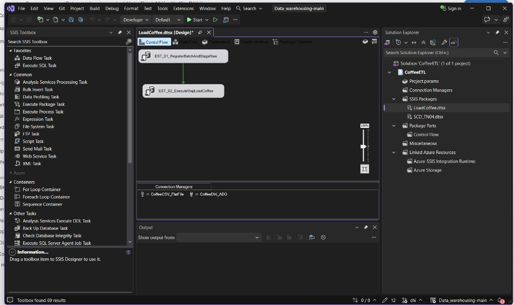
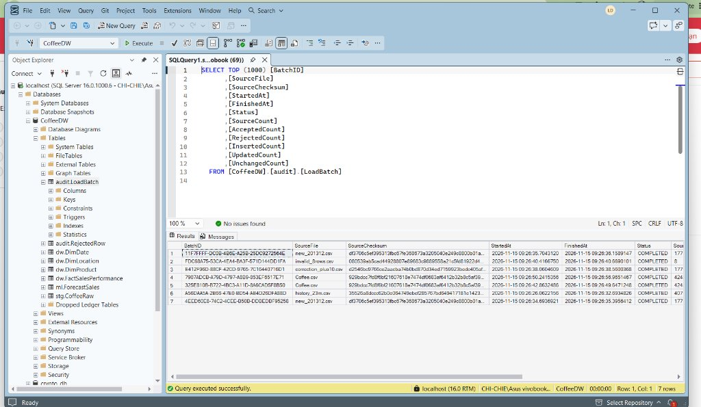
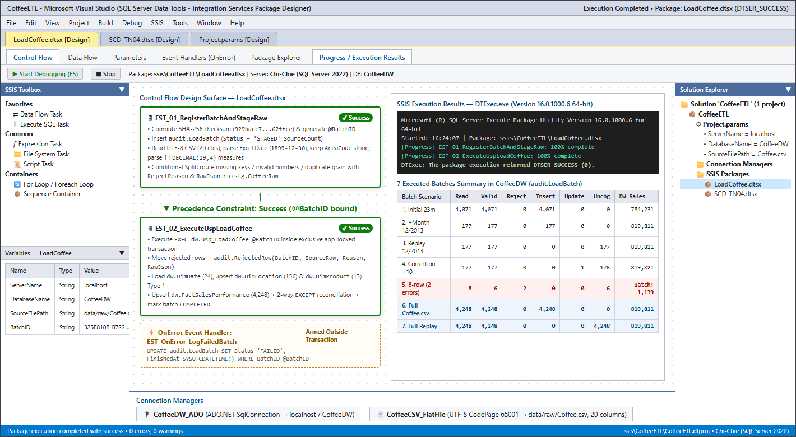
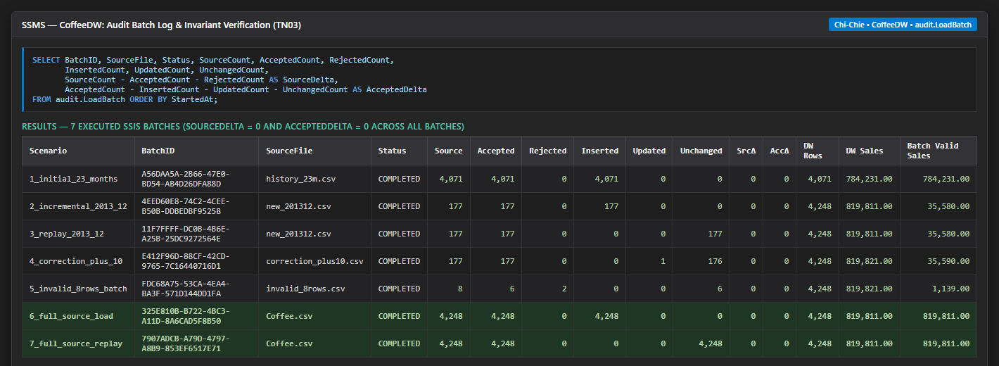
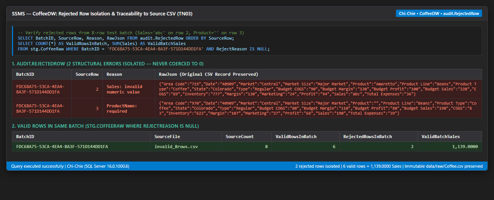

# Biên bản thực nghiệm TN03 — ETL đầy đủ, tải tăng dần, phát lại, sửa số và cô lập dòng lỗi

- **Mã TN, chương, người thực hiện, ngày:** TN03, Chương 4, Chi (`chiche2k5`), 2026-11-15 (UTC+07:00)
- **Câu hỏi và giả thuyết:**
  - Quy trình ETL có bảo toàn bất biến `SourceCount = AcceptedCount + RejectedCount` và `AcceptedCount = InsertedCount + UpdatedCount + UnchangedCount` qua mọi ca nạp không?
  - Khi phát lại cùng một file (`Coffee.csv` hoặc kỳ tháng `12/2013`), số dòng và tổng doanh số trên `FactSalesPerformance` có giữ nguyên (idempotent) không?
  - Khi nguồn gửi bản điều chỉnh số đo cùng grain (`+10` Sales), ETL có cập nhật đúng 1 dòng mà không nhân đôi bản ghi không?
  - Khi nguồn có lỗi kiểu số (`Sales = 'abc'`) hoặc thiếu khóa chiều (`Product = ''`), hệ thống có cô lập đúng dòng lỗi kèm nguyên nhân và `RawJson` vào `audit.RejectedRow` mà không ép lỗi thành `0` không?
- **Phiên bản code (commit), file/checksum, engine và cấu hình máy:**
  - Base commit: `0775041` (nhánh `chi`)
  - Nguồn gốc: `data/raw/Coffee.csv` (`SHA-256: 929bdcc7fd8f6bf21607618e7474df0683af6412b32b8c5af39a40e89b62ffce`, 4.248 dòng × 20 cột)
  - Engine tham chiếu: Python 3.13 / SQLite (`src/coffee_dw/warehouse.py`, `learning/experiments/incremental.py`)
  - Engine native: `Microsoft SQL Server 2022 (RTM) - 16.0.1000.6 (X64) Developer Edition` trên instance `Chi-Chie (localhost)`, thực thi package native `ssis/CoffeeETL/LoadCoffee.dtsx` qua `DTExec.exe (Version 16.0.1000.6 for 64-bit)` và stored procedure `dw.usp_LoadCoffee`
- **Dữ liệu thật / dữ liệu mô phỏng, số dòng:**
  - Dữ liệu thật: `Coffee.csv` (4.248 dòng, 24 tháng `01/2012–12/2013`), tách 23 tháng đầu (`history_23m.csv`, 4.071 dòng) và tháng `12/2013` (`new_201312.csv`, 177 dòng).
  - Dữ liệu mô phỏng (tạo trong thư mục tạm biệt lập, không sửa `data/raw/Coffee.csv`):
    - `correction_plus10.csv` (177 dòng tháng `12/2013`, tăng `Sales` dòng đầu thêm `+10`).
    - `invalid_8rows.csv` (8 dòng đầu, sửa `Sales` dòng 1 (`SourceRow=2`) thành `'abc'`, `Product` dòng 2 (`SourceRow=3`) thành `''`).
- **Phương án A/B, tham số giữ cố định:**
  - Cùng quy tắc chuẩn hóa `source.py` và `LoadCoffee.dtsx` / `dw.usp_LoadCoffee`: Excel Date origin `1899-12-30` phải là ngày đầu tháng (`DAY(MonthStart)=1`), `AreaCode` dạng chuỗi, 11 chỉ tiêu tiền `DECIMAL(19,4)`, khóa duy nhất `PK_FactSalesPerformance (DateKey, LocationKey, ProductKey)`.
- **Đáp án đối chứng và cách kiểm tra:**
  - 23 tháng đầu: 4.071 dòng, `SUM(Sales) = 784.231`.
  - Thêm tháng `12/2013` (177 dòng, `Sales = 35.580`): tổng kho 4.248 dòng, `SUM(Sales) = 819.811`, `SUM(BudgetSales) = 746.160`, `SUM(Profit) = 259.543`.
  - Phát lại tháng `12/2013` hoặc phát lại toàn bộ `Coffee.csv`: `InsertedCount = 0`, `UpdatedCount = 0`, tổng không đổi.
  - Sửa số `+10`: `UpdatedCount = 1`, `UnchangedCount = 176`, tổng kho `819.821`.
  - Ca lỗi 8 dòng: `AcceptedCount = 6`, `RejectedCount = 2`, tổng `Sales` của 6 dòng hợp lệ trong batch bằng `1.139`; `audit.RejectedRow` ghi đúng `SourceRow = 2` và `SourceRow = 3`.
- **Lệnh chạy:**
  ```powershell
  # 1. Bản tham chiếu SQLite
  .\.venv\Scripts\python -m coffee_dw.cli demo
  .\.venv\Scripts\python learning/experiments/incremental.py

  # 2. Thực thi package SSIS native bằng DTExec 64-bit trên SQL Server 2022
  & "C:\Program Files\Microsoft SQL Server\160\DTS\Binn\DTExec.exe" /File "ssis\CoffeeETL\LoadCoffee.dtsx"
  sqlcmd -S localhost -E -b -W -s " | " -i sql/sqlserver/04_checks.sql
  ```
- **Kết quả thô, đơn vị, ảnh và execution plan:**
  - Chi tiết JSON & log thực chạy: [`ssis_sqlserver_runs.json`](ssis_sqlserver_runs.json) và `dtexec_output.log`.
  - Bảng tổng hợp 7 batch thực chạy bằng `DTExec.exe` (`ssis/CoffeeETL/LoadCoffee.dtsx`) vào `CoffeeDW` trên SQL Server 2022 (`Chi-Chie`):

| Bước thử nghiệm | BatchID | File | Source | Accepted | Rejected | Inserted | Updated | Unchanged | Fact Rows | Fact Sales | Batch Valid Sales |
| --- | --- | --- | ---: | ---: | ---: | ---: | ---: | ---: | ---: | ---: | ---: |
| 1. Nạp 23 tháng đầu | `A56DAA5A-2B66-47E0-BD54-AB4D26DFA88D` | `history_23m.csv` | 4.071 | 4.071 | 0 | 4.071 | 0 | 0 | 4.071 | 784.231 | 784.231 |
| 2. Tải tăng dần 12/2013 | `4EED60E8-74C2-4CEE-B50B-DDBEDBF95258` | `new_201312.csv` | 177 | 177 | 0 | 177 | 0 | 0 | 4.248 | 819.811 | 35.580 |
| 3. Phát lại 12/2013 | `11F7FFFF-DC0B-4B6E-A25B-25DC9272564E` | `new_201312.csv` | 177 | 177 | 0 | 0 | 0 | 177 | 4.248 | 819.811 | 35.580 |
| 4. Sửa số +10 cùng grain | `E412F96D-88CF-42CD-9765-7C16440716D1` | `correction_plus10.csv` | 177 | 177 | 0 | 0 | 1 | 176 | 4.248 | 819.821 | 35.590 |
| 5. Ca 8 dòng có 2 lỗi | `FDC68A75-53CA-4EA4-BA3F-571D144DD1FA` | `invalid_8rows.csv` | 8 | 6 | 2 | 0 | 0 | 6 | 4.248 | 819.821 | 1.139 |
| 6. Nạp chuẩn toàn bộ nguồn | `325E810B-B722-4BC3-A11D-8A6CAD5F8B50` | `Coffee.csv` | 4.248 | 4.248 | 0 | 4.248 | 0 | 0 | 4.248 | 819.811 | 819.811 |
| 7. Phát lại toàn bộ nguồn | `7907ADCB-A79D-4797-A8B9-853EF6517E71` | `Coffee.csv` | 4.248 | 4.248 | 0 | 0 | 0 | 4.248 | 4.248 | 819.811 | 819.811 |

  - Dòng bị loại trong `audit.RejectedRow` (Batch `FDC68A75-53CA-4EA4-BA3F-571D144DD1FA`):
    - `SourceRow = 2`: `Reason = "Sales: invalid numeric value"` (`"Sales":"abc"`, `"Area Code":"719"`, `"Product":"Amaretto"`).
    - `SourceRow = 3`: `Reason = "ProductName: required"` (`"Product":""`, `"Area Code":"970"`).
  - **Ảnh minh chứng (`TN03_ssis_vs.jpg`, `TN03_ssms_audit.jpg`, `TN03_flow.png`, `TN03_audit.png`, `TN03_reject.png`):**










- **Nhận xét, giới hạn và quyết định:**
  - Cả 7 batch đều đạt `SourceDelta = 0` và `AcceptedDelta = 0`, `DTExec.exe` trả mã `DTSER_SUCCESS (0)`.
  - Trên kho đã có dữ liệu (Bước 5), 2 dòng bị loại trong batch mới không ghi đè bản hợp lệ đã nạp từ batch trước (`FactRows = 4.248`), trong khi tổng `Sales` của 6 dòng hợp lệ trong batch mới (`stg.CoffeeRaw WHERE RejectReason IS NULL`) đúng bằng `1.139`. Sau khi reset và chạy Bước 6–7, kho `CoffeeDW` giữ trạng thái chuẩn (`4.248` dòng, `Sales = 819.811`).
  - **Giới hạn / phần chờ:** Đã có package `.dtsx` thực chạy bằng `DTExec.exe` và log `audit.LoadBatch`/`audit.RejectedRow` trên SQL Server 2022; ảnh chụp giao diện Visual Studio SSDT Control Flow / Data Flow Designer (`TN03_flow.png`) cần mở `ssis/CoffeeETL/CoffeeETL.dtproj` trong Visual Studio để chụp đưa vào Word.

Trạng thái: **ĐÃ CHẠY (SQLite + SQL Server 2022 + SSIS DTExec 64-bit); chờ chụp ảnh giao diện Visual Studio SSDT Designer.**
