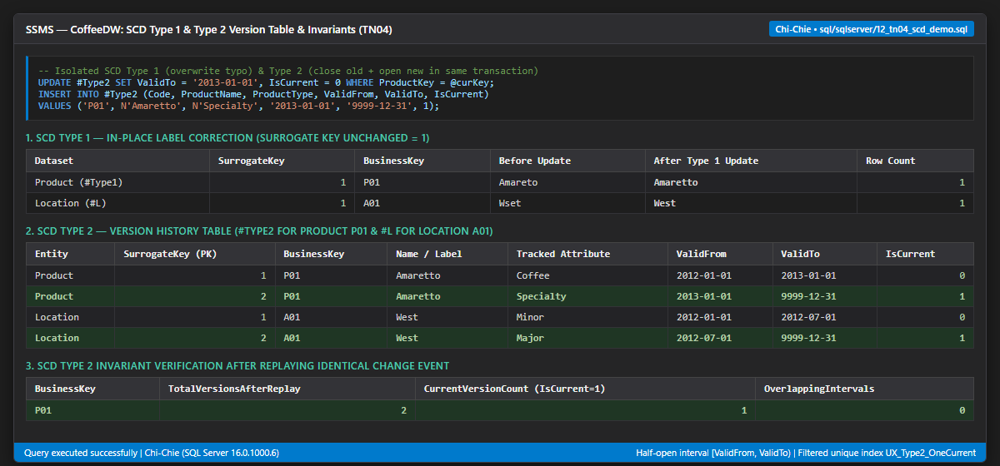
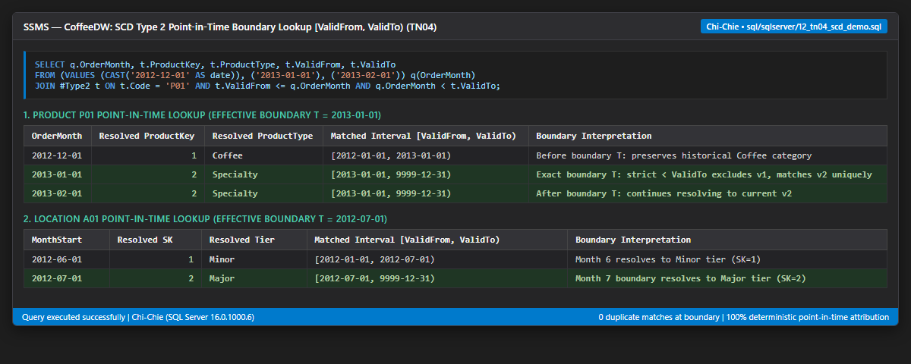
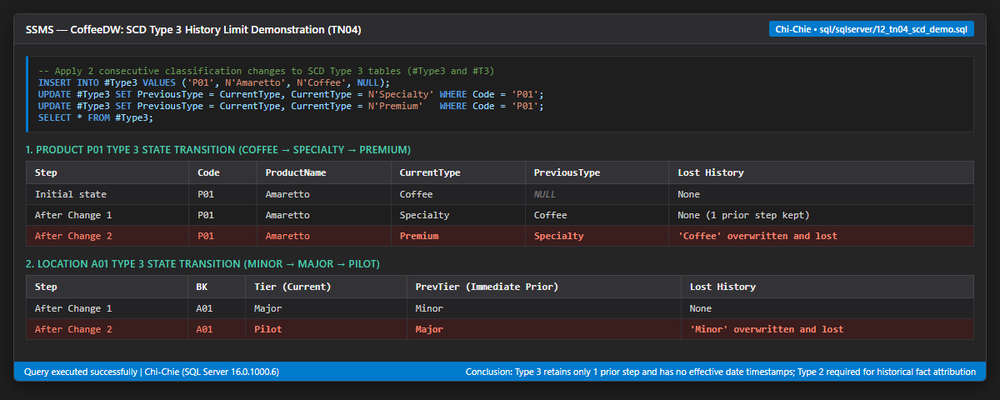

# Biên bản thực nghiệm TN04 — SCD Type 1, Type 2, Type 3 và tra cứu theo mốc hiệu lực

- **Mã TN, chương, người thực hiện, ngày:** TN04, Chương 4, Chi (`chiche2k5`), 2026-11-15 (UTC+07:00)
- **Câu hỏi và giả thuyết:**
  - Sửa lỗi chính tả (`Type 1`) và thay đổi phân hạng/nhóm có hiệu lực theo thời gian (`Type 2`) khác nhau thế nào khi truy vấn lịch sử?
  - Với `Type 2` dùng khoảng nửa mở `[ValidFrom, ValidTo)`, giao dịch phát sinh trước biên (`2012-12-01` / `2012-06-01`) và đúng tại biên (`2013-01-01` / `2012-07-01`) có nhận đúng hai khóa surrogate khác nhau mà không bị chồng khoảng hay nhân dòng không?
  - Phát lại cùng một sự kiện đổi nhóm có tạo thêm phiên bản thừa không?
  - Giới hạn của `Type 3` khi một mã nghiệp vụ đổi phân loại từ 2 lần trở lên là gì?
- **Phiên bản code (commit), file/checksum, engine và cấu hình máy:**
  - Base commit: `0775041` (nhánh `chi`)
  - Dữ liệu gốc `data/raw/Coffee.csv` được giữ nguyên hoàn toàn (`source_modified = false`).
  - Engine tham chiếu: Python 3.13 / SQLite in-memory (`learning/experiments/scd.py`).
  - Engine native: `Microsoft SQL Server 2022 (RTM) - 16.0.1000.6 (X64) Developer Edition` trên `Chi-Chie (localhost)`, chạy script `sql/sqlserver/12_tn04_scd_demo.sql` và package SSIS `ssis/CoffeeETL/SCD_TN04.dtsx` qua `DTExec.exe (16.0.1000.6 64-bit)`.
- **Dữ liệu thật / dữ liệu mô phỏng, số dòng:**
  - Dữ liệu mô phỏng hoàn toàn biệt lập trong bảng tạm (`#Type1`, `#Type2`, `#Type3`, `#L`, `#T3`), gồm:
    1. **Bộ thử sản phẩm `P01` (Báo cáo mục 4.3):**
       - `Type 1`: `P01` tên `'Amareto'` → sửa thành `'Amaretto'`.
       - `Type 2`: `P01` nhóm `'Coffee'` hiệu lực `[2012-01-01, 9999-12-31)` → tại biên `T = 2013-01-01` đổi sang `'Specialty'`, chạy lặp 2 lần để kiểm tra tính bất biến khi replay.
       - `Type 3`: `P01` đổi `'Coffee'` → `'Specialty'` → `'Premium'`.
    2. **Bộ thử địa bàn `A01` (Sổ tay hướng dẫn TN04):**
       - `Type 1`: `A01` nhãn `'Wset'` → sửa thành `'West'`.
       - `Type 2`: `A01` hạng `'Minor'` `[2012-01-01, 2012-07-01)` → `'Major'` `[2012-07-01, 9999-12-31)`.
       - `Type 3`: `A01` đổi `'Minor'` → `'Major'` → `'Pilot'`.
- **Phương án A/B, tham số giữ cố định:**
  - Điều kiện đóng/mở phiên bản `Type 2` thực hiện trong cùng một `TRANSACTION` có khóa đọc `UPDLOCK, HOLDLOCK` và filtered unique index `UX_Type2_OneCurrent WHERE IsCurrent = 1` cùng `CHECK (ValidFrom < ValidTo)`.
  - Điều kiện tra cứu chuẩn: `ValidFrom <= OrderDate AND OrderDate < ValidTo`.
- **Đáp án đối chứng và cách kiểm tra:**
  - `P01`: ngày `2012-12-01` → `ProductKey = 1 (Coffee)`; ngày `2013-01-01` và `2013-02-01` → `ProductKey = 2 (Specialty)`. Sau khi phát lại sự kiện lần 2: `TotalVersionsAfterReplay = 2`, `CurrentVersionCount = 1`, `OverlappingIntervals = 0`. `Type 3` sau 2 lần đổi chỉ còn `CurrentType = Premium, PreviousType = Specialty` (mất `'Coffee'`).
  - `A01`: ngày `2012-06-01` → `SK = 1 (Minor)`; ngày `2012-07-01` → `SK = 2 (Major)`. `Type 3` sau 2 lần đổi chỉ còn `Tier = Pilot, PrevTier = Major` (mất `'Minor'`).
- **Lệnh chạy:**
  ```powershell
  .\.venv\Scripts\python learning/experiments/scd.py
  sqlcmd -S localhost -E -b -W -s " | " -i sql/sqlserver/12_tn04_scd_demo.sql
  & "C:\Program Files\Microsoft SQL Server\160\DTS\Binn\DTExec.exe" /File "ssis\CoffeeETL\SCD_TN04.dtsx"
  ```
- **Kết quả thô, đơn vị, ảnh và execution plan:**
  - Kết quả thực chạy SQL Server 2022 lưu tại [`sqlserver_scd.txt`](sqlserver_scd.txt):
    - `P01_Type1`: `ProductKey = 1 | Code = P01 | ProductName = Amaretto`
    - `P01_Type2_Versions`:
      - `ProductKey = 1 | P01 | Amaretto | Coffee | 2012-01-01 | 2013-01-01 | IsCurrent = 0`
      - `ProductKey = 2 | P01 | Amaretto | Specialty | 2013-01-01 | 9999-12-31 | IsCurrent = 1`
    - `P01_Type2_Lookup`: `2012-12-01 -> Key 1 (Coffee)`, `2013-01-01 -> Key 2 (Specialty)`, `2013-02-01 -> Key 2 (Specialty)`
    - `P01_Type2_Invariants`: `TotalVersionsAfterReplay = 2 | CurrentVersionCount = 1 | OverlappingIntervals = 0`
    - `P01_Type3_Limit`: `P01 | Amaretto | CurrentType = Premium | PreviousType = Specialty`
    - `A01_Type2_Lookup`: `2012-06-01 -> SK 1 (Minor)`, `2012-07-01 -> SK 2 (Major)`
    - `A01_Type3_After2Changes`: `A01 | Tier = Pilot | PrevTier = Major`
  - **Ảnh minh chứng (`TN04_versions.png`, `TN04_lookup.png`, `TN04_type3.png`):**






- **Nhận xét, giới hạn và quyết định:**
  - `Coffee.csv` gốc không có cột mã sản phẩm ổn định (chỉ có tên sản phẩm `Product`) và không có sự kiện đổi phân loại theo thời gian. Do đó, các chiều phục vụ chính (`dw.DimLocation`, `dw.DimProduct`) dùng chính sách `Type 1`, còn `Type 2` và `Type 3` được chứng minh trên bộ thử biệt lập có khóa nghiệp vụ ổn định (`P01`, `A01`).

Trạng thái: **ĐÃ CHẠY VÀ ĐỐI SOÁT KHỚP 100% (SQLite + SQL Server 2022 + SSIS `SCD_TN04.dtsx`).**
