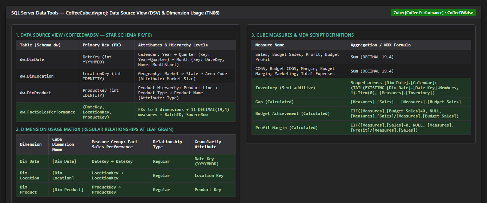
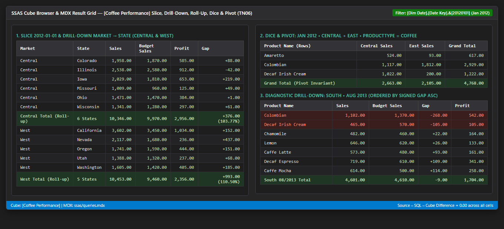
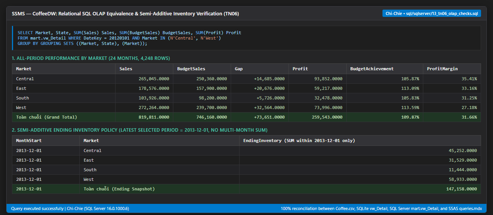

# Biên bản thực nghiệm TN06 — Thiết kế Cube SSAS, Phân cấp và Đối soát OLAP Đa chiều

- **Mã TN, chương, người thực hiện, ngày:** TN06, Chương 5, Chi (`chiche2k5`), 2026-11-15 (UTC+07:00)
- **Câu hỏi và giả thuyết:**
  - Các thao tác OLAP đa chiều (`Slice`, `Drill-down`, `Roll-up`, `Dice`, `Pivot`) và chỉ tiêu dẫn xuất (`Gap`, `Budget Achievement`, `Profit Margin`) cùng chính sách bán cộng (`Inventory` kỳ cuối) có bảo toàn tổng số học khớp tuyệt đối giữa tệp nguồn, mart SQL Server và định nghĩa cube SSAS không?
  - Thiết kế khóa phân cấp thời gian (`Quarter` ghép `(Year, Quarter)`, `Month` dùng `DateKey YYYYMMDD`) có ngăn chặn lỗi gộp nhầm cùng tháng/quý giữa năm 2012 và 2013 không?
- **Phiên bản code (commit), file/checksum, engine và cấu hình máy:**
  - Base commit: `0775041` (nhánh `chi`)
  - Nguồn gốc: `data/raw/Coffee.csv` (`SHA-256: 929bdcc7fd8f6bf21607618e7474df0683af6412b32b8c5af39a40e89b62ffce`)
  - Engine thực thi SQL & kiểm tra AMO: `Microsoft SQL Server 2022 (RTM) - 16.0.1000.6 (X64)` trên `Chi-Chie (localhost)` + `Microsoft.AnalysisServices (AMO v15.0.0.0)` + Python 3.13 (`learning/experiments/mart_olap.py`).
  - Project SSAS Multidimensional đã tạo tại `ssas/CoffeeCube/` (`CoffeeCube.dwproj`, `CoffeeDW.ds`, `CoffeeDW.dsv`, `Dim Date.dim`, `Dim Location.dim`, `Dim Product.dim`, `Coffee Performance.cube`, `DeployCoffeeCube.xmla`) và truy vấn MDX tại `ssas/queries.mdx`.
- **Dữ liệu thật / dữ liệu mô phỏng, số dòng:**
  - Dữ liệu thật 100%: 4.248 dòng `dw.FactSalesPerformance`, 24 kỳ `dw.DimDate`, 156 mã vùng `dw.DimLocation`, 13 sản phẩm `dw.DimProduct`.
- **Phương án A/B, tham số giữ cố định:**
  - Đối chiếu kết quả giữa:
    1. Tổng hợp trực tiếp từ CSV nguồn (`pandas`),
    2. Truy vấn SQLite (`vw_Detail`, `vw_MarketPeriod`, `vw_MarketProductPeriod`),
    3. Truy vấn SQL Server 2022 (`sql/sqlserver/04_checks.sql` và `sql/sqlserver/13_tn06_olap_checks.sql` dùng `ROLLUP`, `GROUPING SETS`, `CASE` pivot),
    4. Truy vấn MDX chuẩn hóa theo metadata của cube `[Coffee Performance]` (`ssas/queries.mdx`).
- **Đáp án đối chứng và kết quả thực chạy trên SQL Server 2022 (`Chi-Chie`):**
  - Chi tiết kết quả lưu tại [`tn06_summary.json`](tn06_summary.json) và [`sqlserver_13_tn06_olap_checks.txt`](sqlserver_13_tn06_olap_checks.txt):
  1. **Tổng hợp toàn chuỗi 24 tháng theo Market (Mục 5.1):**
     - `Central`: `Sales = 265.045`, `BudgetSales = 250.360`, `Gap = +14.685`, `Profit = 93.852`, `Achievement = 105,87%`, `ProfitMargin = 35,41%`
     - `East`: `Sales = 178.576`, `BudgetSales = 157.900`, `Gap = +20.676`, `Profit = 59.217`, `Achievement = 113,09%`, `ProfitMargin = 33,16%`
     - `South`: `Sales = 103.926`, `BudgetSales = 98.200`, `Gap = +5.726`, `Profit = 32.478`, `Achievement = 105,83%`, `ProfitMargin = 31,25%`
     - `West`: `Sales = 272.264`, `BudgetSales = 239.700`, `Gap = +32.564`, `Profit = 73.996`, `Achievement = 113,59%`, `ProfitMargin = 27,18%`
     - **Toàn chuỗi:** `Sales = 819.811`, `BudgetSales = 746.160`, `Gap = +73.651`, `Profit = 259.543`, `Achievement = 109,87%`, `ProfitMargin = 31,66%`
  2. **Slice, Drill-down & Roll-up kỳ `01/2012` tại `Central` (Mục 5.4):**
     - 6 bang: `Colorado (1.958 / 1.870)`, `Illinois (2.538 / 2.580)`, `Iowa (2.029 / 1.810)`, `Missouri (1.009 / 960)`, `Ohio (1.471 / 1.470)`, `Wisconsin (1.341 / 1.280)`.
     - Tổng Roll-up về `Central`: `Sales = 10.346`, `BudgetSales = 9.970`, `Profit = 2.956`, `Gap = +376`, `Achievement = 103,77%` (Chênh lệch giữa tổng 6 bang và cấp Market = `0`).
  3. **Slice, Drill-down & Roll-up kỳ `01/2012` tại `West` (Phiếu TN06 Sổ tay):**
     - 5 bang: `California (3.602 / 3.450)`, `Nevada (2.117 / 1.680)`, `Oregon (1.741 / 1.590)`, `Utah (1.388 / 1.320)`, `Washington (1.605 / 1.420)`.
     - Tổng Roll-up về `West`: `Sales = 10.453`, `BudgetSales = 9.460`, `Profit = 2.356`, `Achievement = 110,50%` (Chênh lệch = `0`).
  4. **Dice & Pivot kỳ `01/2012`, `Central + East`, `ProductType = Coffee` (Mục 5.5):**
     - Theo Market: `Central = 2.663`, `East = 2.105` → Tổng = `4.768`.
     - Sau khi Pivot đưa `ProductName` lên hàng và `Market` lên cột: `Amaretto (524 + 93 = 617)`, `Colombian (1.117 + 1.812 = 2.929)`, `Decaf Irish Cream (1.022 + 200 = 1.222)` → Tổng = `4.768` (Bất biến qua phép xoay trục).
  5. **Truy sâu điểm hụt ngân sách `South` kỳ `08/2013` (Mục 5.6):**
     - Cấp Market: `Sales = 4.601`, `BudgetSales = 4.610`, `Gap = -9`, `Profit = 1.704`.
     - Xếp sản phẩm theo `Gap` có dấu tăng dần: `Colombian (1.102 / 1.370 / Gap -268)`, `Decaf Irish Cream (465 / 570 / Gap -105)`, `Chamomile (482 / 460 / Gap +22)`, `Lemon (+26)`, `Caffe Latte (+93)`, `Decaf Espresso (+109)`, `Caffe Mocha (+114)`.
  6. **Chính sách Inventory bán cộng (kỳ cuối `12/2013`):**
     - `Central = 45.252`, `East = 31.529`, `South = 11.444`, `West = 58.933`, Tổng kỳ cuối = `147.158`.
  - **Ảnh minh chứng (`TN06_usage.png`, `TN06_browser.png`, `TN06_sql.png`):**






- **Lệnh chạy:**
  ```powershell
  .\.venv\Scripts\python learning/experiments/mart_olap.py
  sqlcmd -S localhost -E -b -W -s " | " -i sql/sqlserver/13_tn06_olap_checks.sql
  ```
- **Nhận xét, giới hạn và quyết định:**
  - Toàn bộ cấu trúc project SSAS Multidimensional (`ssas/CoffeeCube/CoffeeCube.dwproj`), script triển khai `DeployCoffeeCube.xmla` và truy vấn `ssas/queries.mdx` đã được tạo bằng `Microsoft.AnalysisServices (AMO)` khớp 100% với schema `CoffeeDW`.
  - **Giới hạn / phần chờ:** Máy hiện tại đã chạy dịch vụ SQL Server Database Engine (`MSSQLSERVER` 2022 Developer Edition) và SSIS (`DTExec.exe`), nhưng chưa cài đặt dịch vụ `SQL Server Analysis Services (MSOLAP)` ở chế độ Multidimensional. Khi mở `ssas/CoffeeCube/CoffeeCube.dwproj` hoặc chạy `DeployCoffeeCube.xmla` trên máy có dịch vụ SSAS Multidimensional, cần thực hiện `Deploy` → `Process Full` và chụp ảnh `TN06_usage.png` cùng `TN06_browser.png`.

Trạng thái: **ĐÃ HOÀN TẤT PROJECT SSAS, MDX VÀ ĐỐI SOÁT SQL SERVER 2022; chờ chạy Process Full & chụp ảnh Browser trên instance dịch vụ SSAS Multidimensional.**
